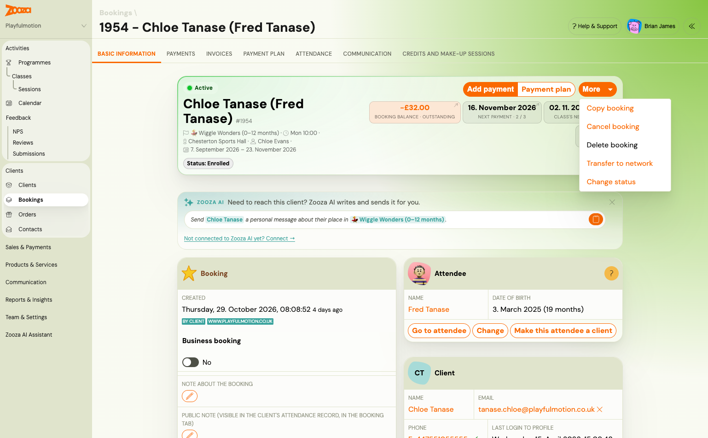
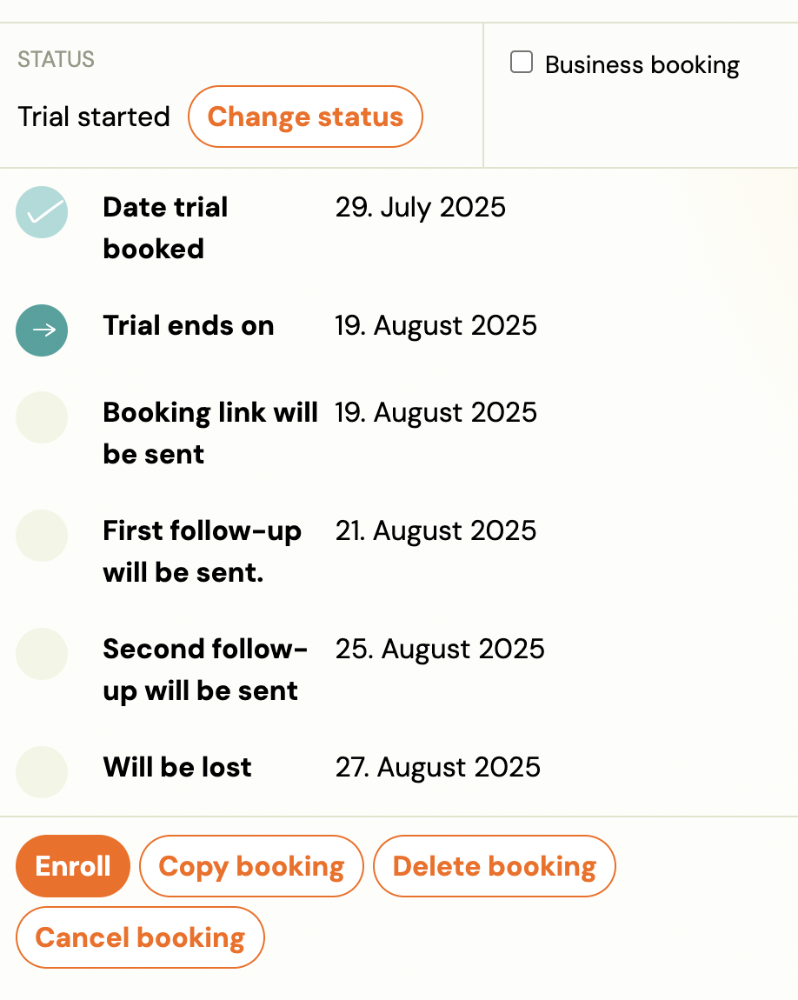
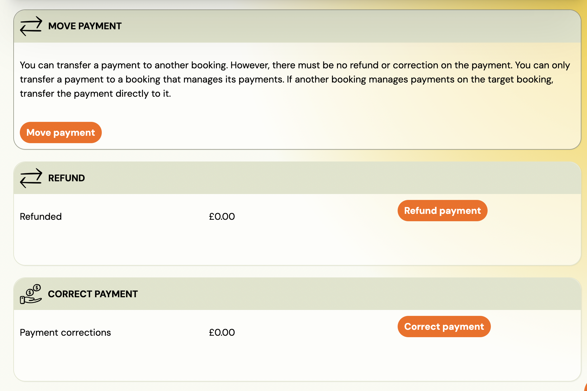

# Common Booking Scenarios

## 1. How do I delete a booking?

Use this when the client never started, or the booking is a duplicate or a test.

Open the booking and use **More → Delete booking**. The **More** menu sits at the top
right of the booking, beside **Add payment** and **Payment plan**, and holds **Copy
booking**, **Cancel booking**, **Delete booking**, **Transfer to network** and **Change
status**.

> **It moved on 27 October 2026.** The booking screen was rebuilt and every action now
> lives in that header. Older instructions — including ours until recently — said
> "Change status to Deleted", which went through the status screen. That still works,
> but **Delete booking** is the direct route and the one to teach people.

**Deleting is not erasing.** The booking goes to the Trash and the client record stays
exactly as it was. You can still find it by filtering the bookings list for deleted
bookings, and you can **restore it within 30 days** — see
[Trash and restore](../guides/trash-and-restore.md).

> **Deleting and cancelling are different.** Delete is for a booking that should never
> have existed; **Cancel** is for a real client who is leaving, keeps the record in your
> reports, and since late October asks you for a [cancellation
> reason](../guides/cancellation-reasons.md). Do not delete a leaver to tidy the list —
> it takes them out of your churn figures. See [Cancelled vs deleted](registration-status-faq.md#what-does-cancelled-mean--and-is-it-the-same-as-deleted).

## 2. How do I pause a booking?

Use this when a client takes a break for a defined period and will return — for example, they are away for a few weeks, or the class venue is temporarily unavailable.

**Step 1 — Stop upcoming reminders by cancelling the sessions they'll miss.**

1. Go to **Calendar** and select the sessions that won't take place for this client's period of absence.
2. Click **Bulk Edit → Cancel** (or set individual sessions to Cancelled).
3. Cancelled sessions will not trigger automated reminders.

> If the whole class is pausing (not just one client), cancel the sessions for the whole class. If it's one client only, you can mark their attendance as absent instead — but the reminder will still be sent unless the session itself is cancelled.

**Step 2 — Defer the payment plan so nothing is charged during the break.**

1. Go to **Bookings → Detail → Payments → Payment Plan**.
2. Click on the next scheduled payment.
3. Update the **Scheduled for** date to after the client returns.
4. Save.

Billing will resume from that new date. Any subsequent scheduled payments will shift accordingly if the plan is set to follow-on billing.

**When the client returns:**

- Add back any sessions that were cancelled for their period (if they need to make up missed time), or simply let the next scheduled sessions continue as normal.
- If sessions were deleted rather than cancelled, recreate them from the class detail.

> **Keeping the booking active vs cancelling it:** A paused booking keeps the client's place in the class and their history intact. Use Pause (defer payment + cancel sessions) when the client *will* return. Use Cancel (status → Cancelled) only when they are leaving permanently.

## 3. How do I cancel a booking?

Use this if the client is leaving.
Steps: Bookings → Detail → Change status to Cancelled.
(Keeps history, frees the spot, can be reactivated later.)

## 4. How does the waitlist work?

When a class is full, new clients go to Waitlist automatically.
When a place opens, they receive a notification to confirm.
Steps: Bookings → Detail → Status = Waitlist.

## 5. What is a trial booking?

Clients attending their first class will have a status Trial.
Steps: Bookings → Check that status = Trial.

## 6. How do refunds work?

Refunds (full or partial) can be done directly in Zooza.
Applies to Stripe, not GoCardless, etc.
Steps: Booking → Detail → Payments → Select transaction → Process refund.
(Money is automatically sent to the client. Or note is created and manually process in your payment gateway. )

## 7. How do I handle missed classes?

Go to Booking → Payments → Payment plan → Adjust the next payment.
Automation options (on request):

- Offer [make-up sessions](https://support.zooza.online/portal/en/kb/articles/replacement-lessons).
