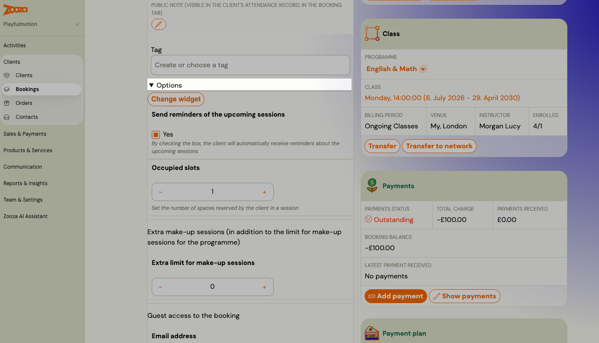

# Registration and Booking FAQ

## Questions answered in the Booking FAQ

These live in [Booking FAQ](booking-faq.md) so there is one answer to find, not two:
booking links, duplicate bookings, deleting test bookings, deleting versus cancelling,
registering several children at once, moving a client to another class, pro-rata for
partial terms, creating a booking on a client's behalf, and why the Clients list is
longer than the booking count.

## Can I stop a booking being made without payment?

Not by blocking it at the door — Zooza works the other way round, and on purpose.

Every booking gets a **grace period** to pay in, reminders go out during it, and
**auto-cancel** clears out the ones still unpaid when it expires. You accept the
booking, then let the system tidy up.

The reasoning: a blocked booking is a lost lead. A parent who cannot finish the form
at 21:00 because their card is upstairs usually does not come back. The same parent
with an unpaid booking and a reminder in their inbox usually pays.

Restricting payment methods does **not** make payment mandatory either — leaving only
card payment enabled still produces bookings that complete unpaid.

Full setup: [Automatically cancel unpaid registrations](../guides/auto-cancel-unpaid-registrations.md).

## How do I add a participant (child) who is different from the buyer (parent) during manual registration?

Zooza distinguishes between the **buyer** (the person who pays, typically the parent) and the **participant** (the person who attends, typically the child). When creating a manual registration:

1. Open the booking form and enter the buyer's details (the parent's name, email, and phone number).
2. In the participant section, select or create the child who will attend. Make sure you do not leave the participant set to the same person as the buyer unless the buyer is also the attendee.
3. Confirm the booking. The buyer receives payment-related communication, while the participant is linked to the class schedule and attendance.

If you need to change the participant on an existing registration, open the booking detail and update the participant field. The **Bookings** list shows labels for both buyer and participant so you can verify the assignment is correct.

<!-- REVIEW: confirm exact UI field names for buyer/participant selection on manual registration -->

## How do I resend the registration confirmation email to a client?

1. Open the booking detail for the registration.
2. Click the **Communication** tab or scroll to the communication section.
3. Click **Send email**.
4. Select the appropriate email template — usually **Registration confirmation** or a similar template.
5. Click **Send**.

The email is sent immediately to the client's address on the booking. You can use this to re-send any transactional email tied to a booking, not just the initial confirmation.

## Can I search for and restore deleted bookings?

Yes. Deleted bookings are kept in **Trash** for 30 days and can be restored with a single click.

## Why does the basket/checkout summary show only the registration fee and not the full course price?

This is intentional. When a client registers (including when registering multiple children in one basket), the checkout summary shows the **registration fee** (booking fee) — the amount due immediately at the point of sign-up. The full course price is not shown in the basket because it is collected later through payment instalments.

The registration fee is a one-time charge set on the programme. The remaining course price is paid according to the payment plan (weekly, monthly, or a lump sum at a later date), depending on how your programme is configured.

If you do not want to charge a registration fee at all, go to **Programmes → programme → Settings** → the **Price** tile → **Price and payment** and set the booking fee to 0. The basket will then show €0 as the immediate payment.

1. Go to **Settings → Tools → Trash**.
2. Filter by **Type → Registration** to narrow the list.
3. Find the booking and click **Restore**.

See [Recover deleted sessions, classes, and registrations](../guides/trash-and-restore.md) for the full process, including bulk restore.

## Can I add a second email address to a booking for notifications?

Yes. You can add an additional email address on any booking so that a second person (e.g., the other parent) receives session reminders and notifications.

1. Open the booking detail.
2. Click **Additional settings** on the left side panel.
3. Scroll down to the email fields. There are two separate fields:
   - One for **notifications** (session reminders and communication).
   - One for **profile access** (allows the second email holder to view the client profile).
4. Enter the second email address in the appropriate field and save.

This is useful when divorced or separated parents both need visibility into the child's schedule, or when a different family member handles day-to-day logistics.

> **Warning:** If you collect a secondary email address via an **extra field** on the booking form (e.g., Additional field 1), that value is **not** automatically transferred to the system's secondary email field. Extra fields are text-only data collection and are not linked to system notification fields. You must manually copy the email from the extra field into the booking's **Additional settings** → secondary email field for the second parent to actually receive notifications.

## What does the "Date of last registration update" field mean in exports?

The **Date of last registration update** column reflects the timestamp of the most recent change to that registration record — not necessarily any specific event like a cancellation.

It updates whenever **any** field on the registration changes, including:

- payment status changes (paid, partially paid, refunded)
- cancellation or deletion of the registration
- restoring a previously cancelled registration
- changes to notes, assigned class, instructor, or other fields

**Practical implications:**

- If a registration has status `deleted` or `cancelled`, the date shown is **not guaranteed to be the cancellation date** — it is the date of the last change, which may have happened after the cancellation (e.g. a payment adjustment).
- To find the exact cancellation date for a cancelled registration, use the dedicated **Cancellation date** field in the export if available, rather than relying on the last-update timestamp.
- If you are filtering exports for cancelled registrations and need accurate timing, cross-reference the registration status column with the cancellation date column rather than the last-update column.

---

## How do I hide a class from the public booking page and share a private link instead?

Use this when you have classes that should not be publicly listed — for example, school partnership sessions, invite-only groups, or franchise-internal classes.

**Step 1 — Disable public visibility for the class:**

1. Go to **Programmes** → open the programme → select the **Class**.
2. Open **Settings** → the **Booking** tile → **Online booking**.
3. Uncheck `Display in catalogue` (or disable `Allow online booking` to also block booking from direct links).
4. Save.

The class will no longer appear in your public booking widget or booking page catalogue.

**Step 2 — Share a private direct link:**

1. Go to **Programmes** → open the programme → select the **Class**.
2. In the class listing, click **Copy link** (or use the **Customize** option to pre-fill specific details).
3. Share the link directly with the relevant group (e.g. via email or WhatsApp to the school contact).

Parents who receive the direct link can still register — the class is hidden from the public catalogue but bookable via the private URL.

> **Note:** If you want to prevent *any* online booking (not just public listing), disable `Allow online booking` rather than just `Display in catalogue`. Admins can still create bookings manually from the admin panel regardless of this setting.

## Why is my programme not showing on the booking page?

Both `Allow online booking` and `Display in catalogue` must be enabled for a programme to appear on your public booking page.

1. Go to **Programmes** → select the programme → **Edit Settings**.
2. Open the **Online booking** tile.
3. Verify that `Allow online booking` is toggled **on**.
4. Verify that `Display in catalogue` is checked.
5. Save the settings.

If only one of these is enabled, the programme will not be visible to clients. `Allow online booking` controls whether the programme accepts registrations, while `Display in catalogue` controls whether it appears in the website menu and booking form list.

## A client stopped getting session reminders — how do I turn them back on?

Reminders about upcoming sessions can be switched off for a single booking, and once they are, that client quietly stops being reminded. Nothing on the booking advertises it, which is why it usually surfaces as "this one parent never hears from us".

1. Open the booking.
2. In the **left card, scroll to the bottom** and open **Options**.
3. Tick **Send reminders of the upcoming sessions**.

> **This controls session reminders, not every email.** Booking confirmations, payment notices and messages you send by hand are not governed by this box. If a client is getting nothing at all, the cause is more likely delivery — see [Email delivery](../troubleshooting/email-delivery.md).

It is set per booking, not per person: a client with two children in two classes can have one booking reminding them and the other not.

**Other things that live under Options** on the same panel: how many places the booking occupies, an extra make-up allowance on top of the programme limit, guest access to the booking, and which widget the booking belongs to.

