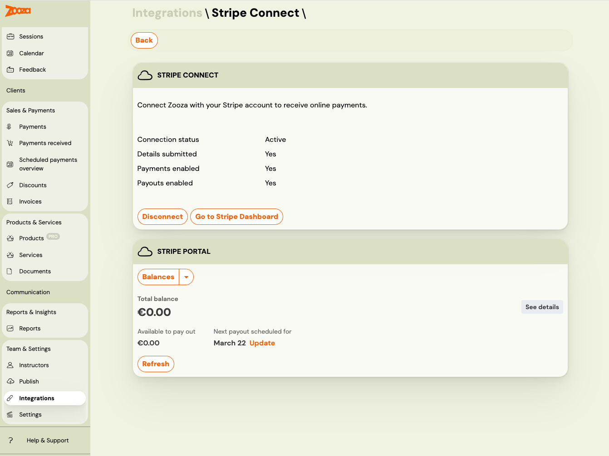

# Stripe Integration FAQ

## Own Stripe account, or Stripe through Zooza?

Two commercial arrangements. They differ in who the client is actually paying — not in how the payment works technically.

| | **Your own Stripe** ⭐ | **Stripe through Zooza** |
|---|---|---|
| Who holds the Stripe account | You | Zooza |
| Who the client pays | You | Zooza s.r.o. |
| Who invoices you | Stripe, for its fees | Zooza, together with the system invoice |
| **What you pay per transaction** | Stripe's own rates, **no Zooza commission** | **3.5%, all in** |
| Payouts | Stripe pays you on its own schedule | Zooza pays out 1–2× per month |
| Setup needed from you | Create a Stripe account | None |

**Your own Stripe is the option we recommend.** Zooza takes no commission on it at all — you pay Stripe's own rates and nothing more. You also keep direct control of payouts, reporting and refunds, which matters on the day a client wants their money back quickly.

**Stripe through Zooza exists for businesses that do not want their own Stripe account.** It works immediately with nothing to set up on your side, and it removes the Stripe Tax Invoice from your books — receiving invoices directly from Stripe can trigger monthly VAT filing, which is a real administrative cost for a small operation. You receive one domestic invoice from us instead.

> **The 3.5% is everything.** It already covers Stripe's own processing fees — they are not charged on top. A transaction never costs you more than 3.5%, so you can quote that figure into your pricing and be done with it.
>
> Compare on total cost, not on the headline: Stripe's own rates are lower than 3.5%, which is why your own account works out cheaper at volume. The flat 3.5% buys you no Stripe account, no Stripe invoices, and one number to reason about.

**What Stripe through Zooza requires:** payouts go only to a verified **legal entity in the EU**, never to a private account. Verification happens once, before the service is switched on. At higher volumes the 3.5% is negotiable, and payouts can be agreed more often than monthly so your cash flow is not held up.

> If you are choosing now and have no strong reason to avoid a Stripe account, open your own. The commission difference compounds with every transaction, and moving later means reconnecting payments mid-season.

> **CardPay** is a third option for card payments and carries the same 3.5%, but it handles **one-off payments only** — there is no automatic recurring charging. For recurring card payments use Stripe; for recurring bank collection use GoCardless.

## What type of Stripe account does Zooza use?

Zooza connects via **Stripe Connect**. All new connections use a **Stripe Standard** account — you get your own full Stripe account and manage it directly at [dashboard.stripe.com](https://dashboard.stripe.com).

If you connected Stripe before March 2026, you may have a **Stripe Express** account. Express accounts are fully supported and continue to work without any changes.

## How do I access my Stripe dashboard?

**Standard account:** Go to [dashboard.stripe.com](https://dashboard.stripe.com) and log in with your Stripe credentials. You have full access to all Stripe features.

**Express account:** Go to **Settings → Integrations → Stripe Connect** and click **Go to Stripe Dashboard**. This generates a secure one-time login link that opens your Express dashboard directly — no need to log in separately.

## Where can I see my Stripe invoices and payout reports?

**Standard account:** Log into [dashboard.stripe.com](https://dashboard.stripe.com) and navigate to your documents section.

**Express account:** Go to **Settings → Integrations → Stripe Connect**. Your Stripe invoices (VAT invoices) and payout reconciliation reports are available directly inside Zooza — no need to open the Stripe dashboard separately.

## Is Apple Pay / Google Pay supported?

Yes. Apple Pay and Google Pay are supported through Stripe. You need to enable them in your Stripe payment method settings. Once enabled, clients will see these options on mobile devices during checkout.

## How do I test payments before going live?

You can test the full payment flow by creating a booking yourself as a client. Use the public booking link, complete the booking, and make a test payment. Remember to:

1. Delete the test bookings afterwards.
2. Restore any prices you changed during testing.
3. Verify that all classes have the correct payment methods enabled.

## Can I onboard Stripe in a different country from my company?

Yes. When you connect Stripe you can pick the country the Stripe account is created
in, instead of taking your company's own region. Zooza offers the countries Stripe
itself supports, so a Slovak company can onboard a Czech Stripe account.

**Choose carefully — Stripe fixes the country when the account is created and it
cannot be changed afterwards.**

If you picked the wrong one, you are not stuck, as long as onboarding never finished:
**reset** the incomplete connected account and connect again with the right country.
Reset only works on an account that has not been completed — an active, onboarded
Stripe account cannot be reset this way, and moving that one is a support
conversation.

## I get an error when trying to set Stripe Connect as the payment provider on a programme

If you see a "provider not connected" error when selecting **Stripe Connect** as the card payment provider on a programme and saving, it means your Stripe Connect account is not currently active in Zooza.

**What to do:**

1. Go to **Settings → Integrations → Stripe Connect** and check the connection status.
2. If the connection has expired or was revoked, click **Connect** and complete the Stripe onboarding or reconnection flow.
3. Once connected, try saving the programme again.

This validation prevents a misconfiguration that would cause payment failures at booking time. Previously, saving would succeed silently but payments would fail when a client tried to pay.

## Parents see "This account cannot currently make live charges" — what happened?

The message comes from Stripe and means the connected account is not able to charge — usually because it is a **new, never-completed Stripe account**, not the one you actually use.

This is how it happens. During Stripe onboarding, Stripe asks whether to sign in to an existing account or create a new one. Choosing *create* — or just clicking through — makes a fresh account with nothing filled in (no support phone, no terms of service, no verification), and Zooza dutifully connects to that one. Repeat the onboarding a few times and you have several half-made accounts and one real one, with the wrong one live.

**When onboarding asks, sign in to your existing Stripe account.** Do not create a new one. Your working account is the one that has already taken payments.

**If you are already in this state:**

1. Go to **Team & Settings → Integrations → Stripe** and note the status and the connected account.
2. In your Stripe dashboard, check which account is fully enabled (verification complete, payouts enabled). The account id (`acct_…`) tells them apart.
3. Ask Zooza support to point the connection at the enabled account. Since 18 September 2026 Zooza can reconnect a previously connected, charge-capable account rather than only creating new ones, and the checkout shows a plain "payments are not available" message in Zooza instead of Stripe's raw error while the account cannot charge.
4. Leave the deletion of the abandoned accounts to Stripe support; it does not affect the working connection.

**Currency:** the region you pick at onboarding decides the currency Stripe offers. A UK-region onboarding will not offer EUR even if your bank account is in EUR — if that is wrong, say so before completing onboarding rather than after.

## Parents cannot pay and the page says "Not secure"

Stripe will not take a live payment on an insecure connection. If the booking page is
being served over `http://` rather than `https://`, the card form fails — on every
device, which is what makes it look like a Zooza fault rather than a website one.

**Check the address bar first.** If the browser says *Not secure*, that is the whole
diagnosis. The Zooza widgets themselves are served securely; what matters is the page
you embedded them into.

**The fix belongs with whoever runs your website:** an automatic redirect from HTTP to
HTTPS across the whole site, set at hosting or domain level. WordPress plugins can do it
too, but the hosting-level redirect is the one that stays fixed.

## A payment shows as expired, or outstanding in Zooza but paid in Stripe

**Expired means the parent started and never finished.** Opening the payment page creates
an intent to pay; walking away from it, or closing the tab, leaves that intent to lapse.
It is not a failure and nothing is charged.

People often try two or three times before one goes through, so a single booking can leave
a trail of expired attempts and one real payment. Look for the successful one before
chasing anybody.

**A parent holding a confirmation email has usually paid** — on a later attempt than the
one you are looking at. Check the booking's payment list rather than the first Stripe row.

## A monthly instalment was never charged, and there is no failed payment to show for it

The booking still says unpaid, the client swears their card is fine, and the payments list shows nothing at all — not even an attempt. That combination has one usual cause: **the saved card no longer exists in Stripe.**

Zooza charges a stored payment method. If that method has been detached or the customer record was deleted on the Stripe side, the charge is refused before any money is touched. Stripe answers with something like `No such PaymentMethod: 'pm_…'`. Because nothing was ever attempted against a card, **no failed payment is recorded** — which is exactly why the screen looks empty rather than red.

**It will keep happening.** Every future instalment on that booking fails the same way until the client pays once more and a new card is stored.

### What to check in Stripe

1. **Customers** → search for the client's email. Under **Payment methods**, see whether a card is still saved.
2. On the same page, open **Events** and look for *payment method was detached* or *customer was deleted* around the date the instalment was due. That tells you when and from where the card went.
3. For the exact request, **Developers → Workbench → Logs**.

### How to get the client paying again

Send them to their client portal to make the payment themselves. Paying there stores a fresh card and the schedule resumes on its own. Do not send them a booking link — that starts a new booking instead of settling the one they have.

> **When the card gets stored in the first place.** Zooza does not keep a card from a trial booking; there is no expectation of recurring payment at that point. The card is stored the first time someone with a payment plan on their booking actually pays. So a client who enrolled but has never completed a payment has nothing on file, and nothing can be collected automatically until they do.

## Where can I see payment reports for my accountant?

Payment reports are available in Zooza under **Reports**. For accounting purposes, the recommended approach is to use Zooza's reports and invoicing integration (Xero, etc.) rather than relying on Stripe's dashboard directly.
