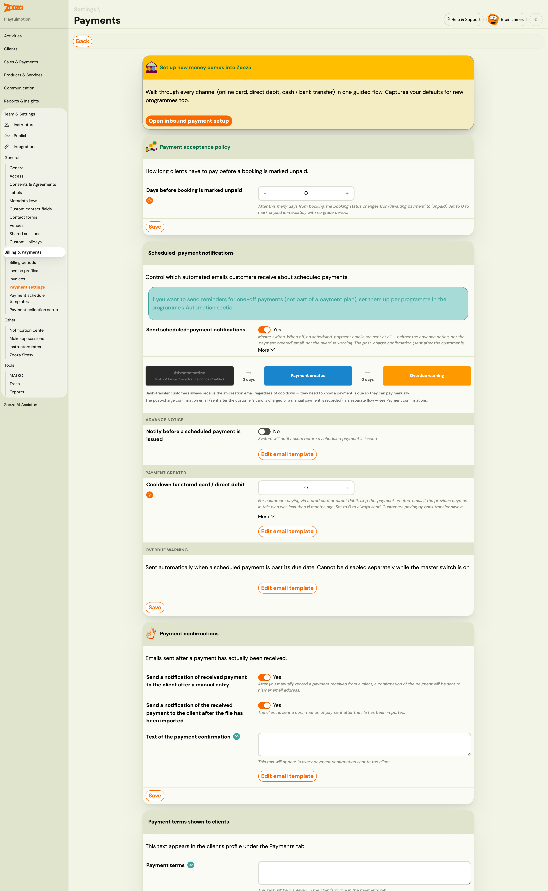
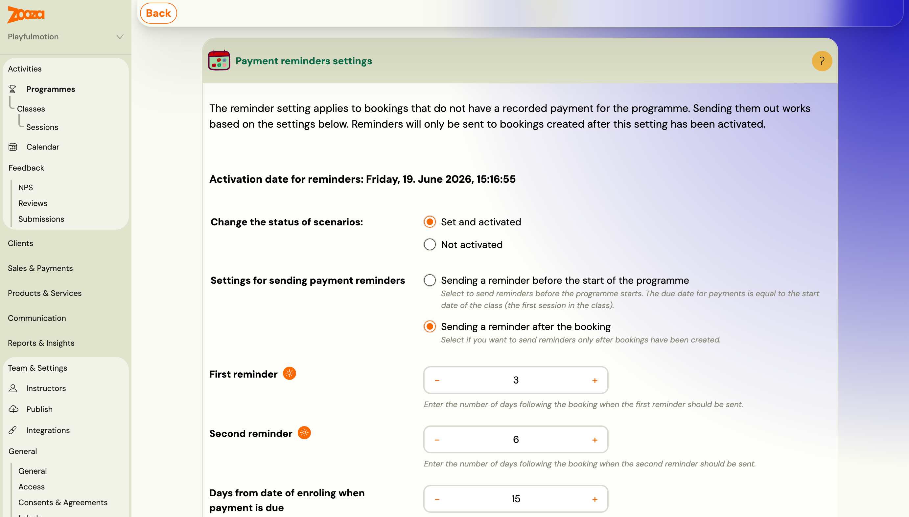
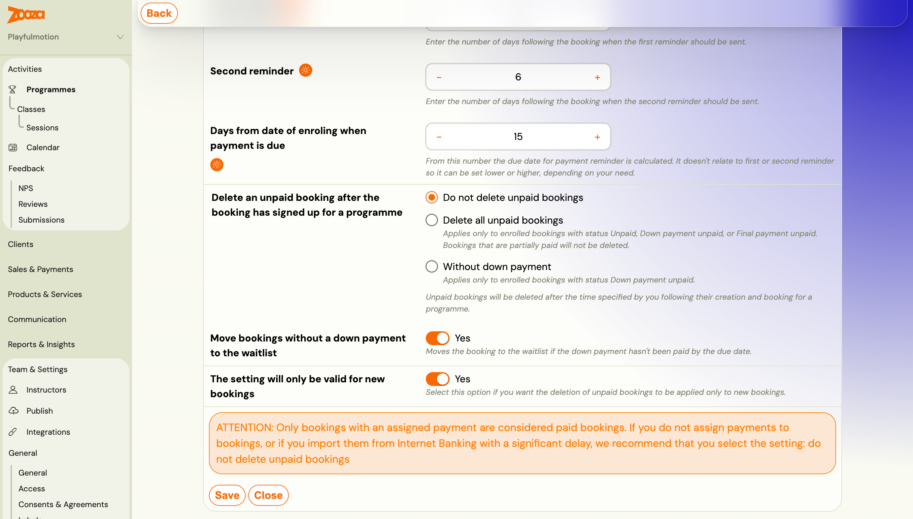

# Automatic reminders for payment schedule

If the client has selected payment with a payment schedule in the booking or you have set it up manually, they will always be informed of this obligation in time -- automatically by the application. Reminders are sent as email notifications. Learn how to set up payment templates in the [payment templates manual](payment-templates-creation.md).

## Reminder 1: Upcoming payment notification

Informs the client that a scheduled payment will be due on their programme booking in a few days (depending on the setup).

1. The reminder must be enabled in **Settings → Billing & Payments → Payment settings → Scheduled-payment notifications**, where you can specify the number of days before the payment is created when the notification should be sent.

2. The notification before the payment is created is sent according to the formula:
   **Due date - Number of days due - Number of days before payment creation**

3. You can edit the text in **Communication --> Message Templates**, under the template titled: **Upcoming Payment**.

4. To communicate the date when the payment will be created, use the dynamic tag: `SCHEDULED_AT_DATE`

## Reminder 2: Payment created notification

Informs the client that a new scheduled payment has been created on their booking. The date when the payment is posted and the notification sent follows the formula: **Due Date - Number of days due**.

1. Set the payment due date in **Settings → Billing & Payments → Payment settings → Payment acceptance policy**, where you can specify the number of days.

2. Customize the text in **Communication --> Message Templates**, under the template named: **New payment**.

3. To communicate the due date, use the dynamic tag: `DUE_DATE`

## Reminder 3: Overdue payment notification

Informs the client that the booking has not been paid by the due date.

1. It is sent on the due date if the booking is in an unpaid/partially paid status.
2. Edit the text in **Communication --> Message Templates**, under the template titled: **Missed payment**.
3. To communicate the due date, use the dynamic tag: `DUE_DATE`

## Understanding the three notification types

Clients often confuse these three notifications. Here is a clear distinction:

| Notification         | When it is sent                                | Purpose                                                     | Template name    |
| -------------------- | ---------------------------------------------- | ----------------------------------------------------------- | ---------------- |
| **Upcoming payment** | Before the debt is created (configurable days) | Informational — tells the client a payment will be due soon | Upcoming Payment |
| **Payment created**  | When the instalment debt is posted             | Action required — tells the client to pay                   | New Payment      |
| **Overdue payment**  | On or after the due date, if unpaid            | Urgent — the payment is past due                            | Missed Payment   |

### Common confusion: "I already paid but got a reminder"

This happens when:

1. The client paid **before** the debt was created (e.g., after receiving the "upcoming payment" notification).
2. The payment was received by the bank but **auto-pairing has not yet processed** it (GoCardless syncs once daily; email-notification pairing is near real-time).
3. The system sent the next scheduled notification before the payment was matched.

The client sees what looks like an overdue notice, but it was actually the "upcoming" or "payment created" notification for a future scheduled payment. The wording of these notifications should clearly distinguish them.

### Notification timing

All payment notifications are processed in a **nightly batch**. This means:

- Notifications may arrive in the early morning hours (e.g., midnight to 6 AM).
- The send time is **not configurable** per programme or globally.
- If this timing causes client complaints, consider adding a note in your notification template explaining that the email was generated automatically overnight.

### The "zeroth" notification (advance notice)

You can enable a notification that is sent **before** the first instalment is created. This gives the client advance notice that they will receive a payment request soon. It acts as a fourth touchpoint in addition to the three reminders above.

Enable this in **Programme → Settings → Price and payment → Payment reminder settings**.

## These are on by default, and there are two ways to time them

Payment reminders do not have to be switched on. **A new programme already has them**, which is why a provider who configured nothing can still find clients being chased — including for a class that has not started.

Open the programme, go to **Price and payment**, scroll to the bottom, and use **Change** on the **Payment reminders settings** card.

### Switching them off

**Change the status of scenarios** → **Not activated**. That is the off switch. (**Delete** on the card removes the whole configuration rather than pausing it.)

### The two timings

This is the setting people most often have wrong, because the two behave completely differently:

| Mode | When reminders go out | What counts as the due date |
|---|---|---|
| **Sending a reminder before the start of the programme** | Counting back from the first session | The class start date |
| **Sending a reminder after the booking** | Counting forward from when each person booked | Set separately, see below |

**First reminder** and **Second reminder** are both a number of days. In the "after the booking" mode they count from the booking, so two people who book a month apart are chased a month apart.

**Days from date of enroling when payment is due** is a third, independent number. It does not follow the first or second reminder and can be set higher or lower than either.

> **Reminders only reach bookings created after you activated the setting.** The card shows the activation date. Switch it on today and the people already owing you money are not chased — only those who book from now on.

### Reminders do not stop when the class starts

The most common misreading of the table above. **"Before the start of the programme" is
where the countdown starts from — it is not a deadline after which reminders stop.**

Since mid-2026 these notifications are triggered by the **booking's status**, not by the
calendar. While a booking sits in **Awaiting payment** and the notification is switched
on, it keeps being sent — including after the first session has been taught. Before that
change they were tied to the class start date, which is where the belief comes from.

So "can I send a reminder 7 days *after* the course starts?" is really two questions:

- *Will somebody who still has not paid be chased once we have started?* Yes, already.
- *Can I set a reminder to go out on day 7 after the start?* Not as a date. Use **Sending
  a reminder after the booking** and count from the booking instead, which is usually
  what you actually want — it chases each person on their own clock rather than
  everybody at once.

> **There are two reminders, not three.** A third reminder does not exist. It has been
> asked for and is on the roadmap, with a caveat worth taking seriously: a client who has
> ignored two emails rarely reads the third, and open rates fall with each one. What
> tends to work better is stopping the service — if an instructor can see an unpaid
> booking, the session arguably should not be taught — or reaching people on
> [WhatsApp](../setup/whatsapp-integration.md), where an unpaid-booking nudge is actually read.

### Deleting unpaid bookings from the same screen

Further down the same panel is a separate decision: whether an unpaid booking should be removed altogether.

| Option | What it removes |
|---|---|
| **Do not delete unpaid bookings** | Nothing. The default, and the safe choice. |
| **Delete all unpaid bookings** | Enrolled bookings with status Unpaid, Down payment unpaid or Final payment unpaid. **Partially paid bookings are never deleted.** |
| **Without down payment** | Only bookings whose down payment is unpaid. |

**Move bookings without a down payment to the waitlist** is the gentler alternative — the place is freed but the person keeps their position rather than disappearing.

> **Read this before switching deletion on.** Only a booking with a *payment assigned to it* counts as paid. If you reconcile bank transfers by hand, or import statements with any delay, a parent who has genuinely paid can still be deleted because the money has not been matched to their booking yet. In that situation leave it on **Do not delete unpaid bookings**.

## Turn off scheduled payment notifications

If you want to stop all payment reminder emails for your clients, you can disable them globally.

Go to **Settings → Billing & Payments → Payment settings → Scheduled-payment notifications** and turn off the **Send scheduled payment notifications** toggle.

When this is off:
- The upcoming payment (pre-notice) email is not sent.
- The payment created email is not sent.
- The overdue payment email is not sent.

**What is not affected:** the payment confirmation email (sent when a payment is successfully processed) — that notification is not controlled by this toggle and is always sent.

## Archiving a class stops its reminders

Archiving a class or a whole programme takes it out of operation, and unpaid bookings inside it stop receiving payment reminders.

This matters if you archive last term's classes to tidy the list. Anyone who never paid stays unpaid — the debt does not disappear — but they stop being chased about a programme that is no longer running.

> If reminders are still going out for something you archived, check that you archived the **class**, not just hid it from the booking form. Hiding a class from the form only affects new registrations.

## Suppress duplicate payment emails (cooldown)

If clients receive multiple payment notifications for recurring charges in quick succession, the cooldown setting can help.

When the master notifications toggle is on, you can set a cooldown in the **Scheduled-payment notifications** card in **Settings → Billing & Payments → Payment settings**. The setting reads: *"For customers paying via stored card or direct debit, skip the 'payment created' email if the previous payment in this plan was less than N months ago."*

If a previous scheduled payment in the same series was processed within the configured window, the at-creation email for that booking is suppressed.

**Who the cooldown applies to:** Stripe stored card and GoCardless inbound clients only.

**Who always gets the email regardless of cooldown:**
- Clients paying by bank transfer (manual recording)
- The first payment in any series

**Default:** notifications on, cooldown = 0 months (no suppression).

> **Suppressed notifications:** When a notification is suppressed by the cooldown, there is no visible indicator in the admin panel. The suppression is logged server-side only. If you need to verify whether a notification was sent, check the client's message history in Communication.
