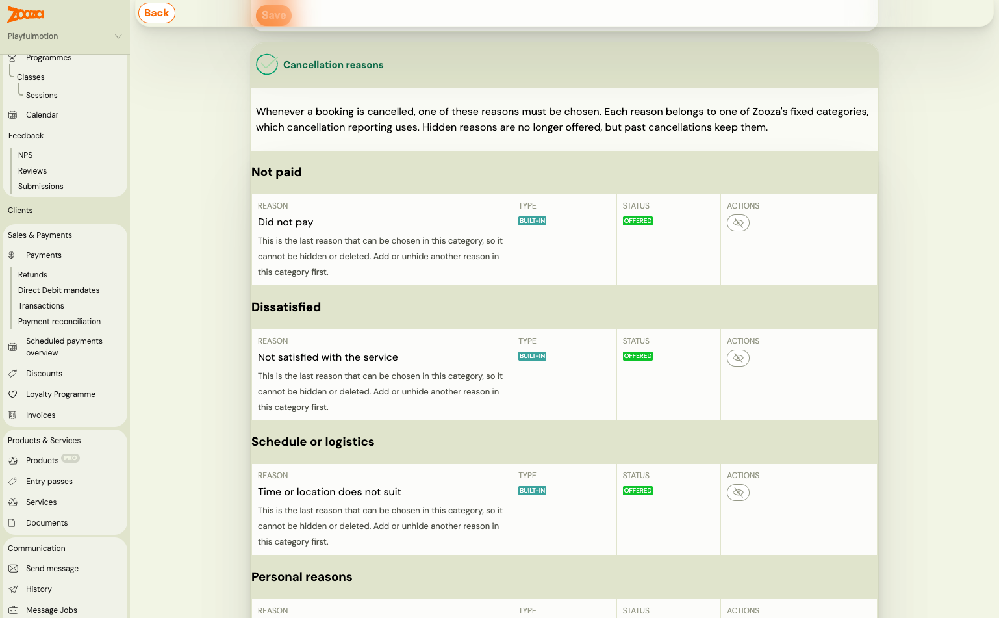
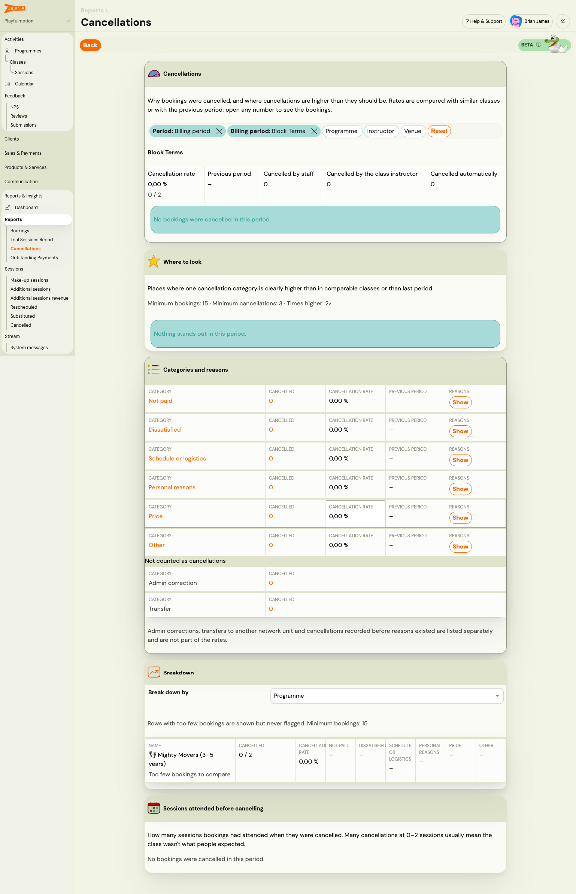
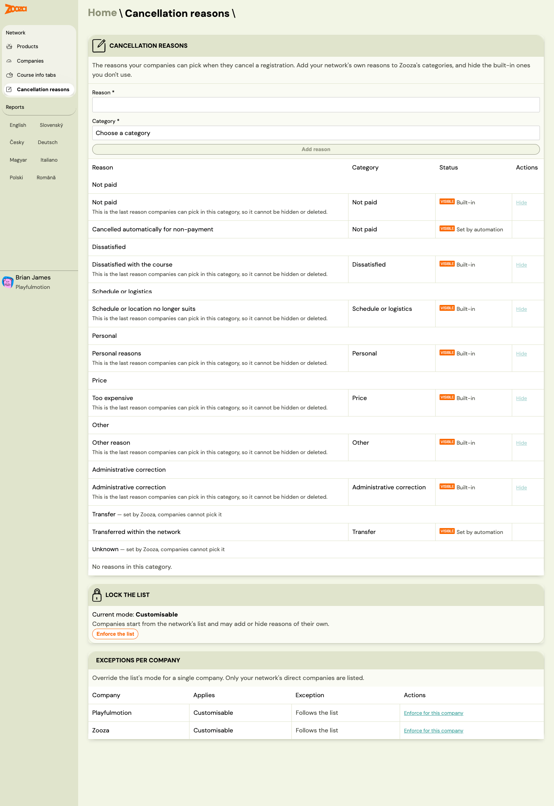

# Record why bookings get cancelled

Since the end of October 2026, cancelling a booking requires a reason. The reason is
saved with the booking, together with who cancelled it and when, and it feeds a
**Cancellations** report that tells you where you are losing people.

Before this, the only "why" Zooza ever recorded was an automatic marker for non-payment,
and nothing recorded who did it. So a leaver was a leaver, whether they had left unhappy
or whether an admin had simply created the booking twice by mistake.

> **This is not the same as a session cancellation reason.** When a parent cancels their
> child out of one session — *Sickness*, *Travel* — that is attendance, and it lives on
> the session. This page is about cancelling the **booking**: the client is leaving the
> class. See [Attendance and make-ups](../faq/attendance-and-catchups-faq.md) for the
> other one.

---

## Your list of reasons

Go to **Settings → General** and find the **Cancellation reasons** card. You need
owner-level access to change it.

The reasons are grouped under their category, and each row shows its **type**
(**Built-in** or your own) and its **status** (**Offered**, or hidden).

Zooza ships a list to start from:

| Reason | Use it for |
|---|---|
| **Did not pay** | They never paid and you are closing the booking |
| **Not satisfied with the service** | They were unhappy with the class, the instructor, the room |
| **Time or location does not suit** | Nothing wrong with the class, wrong slot for this family |
| **Too expensive** | Price was the reason given |
| **Personal or family reasons** | Illness, moving away, a new baby — nothing you could have changed |
| **Booking created by mistake** | An admin correction. **Not counted as a cancellation** |
| **Other reason** | The catch-all. Worth keeping small |

Two more are set by Zooza itself and cannot be chosen by hand: **Cancelled
automatically for non-payment**, and **Network transfer** for a client moving to another
unit of your network. Neither counts as a cancellation in the rates.

**Rename them to your own words.** Add your own with **Add reason**. The list is
yours — these are just a sensible start.

### Every reason sits in a category, and the category is what reporting uses

When you add or edit a reason you pick its **Category**. The report groups by category,
not by your wording, which is what lets you rename *"Too expensive"* to *"Price"* without
breaking last year's numbers.

The categories are fixed by Zooza: **Not paid**, **Dissatisfied**, **Schedule or
logistics**, **Personal**, **Price**, **Other**, **Administrative correction**,
**Transfer** and **Unknown**. The last two are Zooza's own — **Transfer** is set when a
client moves to another unit of your network, and **Unknown** holds cancellations
recorded before reasons existed. Neither can be picked by hand.

Three rules that follow from reasons being saved on real bookings:

- **Renaming a reason also changes the label on past cancellations.** It is the same
  reason, better worded.
- **Moving a reason to another category affects only future cancellations.** Past ones
  stay in the category they had, so historical reports do not shift under you.
- **Hiding or deleting a reason keeps it on past cancellations.** It is simply no longer
  offered. A hidden reason shows as *"(hidden)"* where it was used before.

You cannot hide or delete the **last remaining reason in a category** — add or unhide
another one in that category first. Otherwise a cancellation in that category would have
nothing to choose.

---

## Cancelling a booking

The **Cancellation reason** picker is now part of cancelling, and it is required. Pick
the closest reason and cancel as you always did.

Two things worth knowing when it misbehaves:

- **"There is no cancellation reason to choose from"** means every reason has been
  hidden. The booking cannot be cancelled until you unhide one in **Settings → General**.
- **If the list fails to load, the cancellation is refused** rather than going through
  without a reason. Try again.

Afterwards the booking shows **Cancellation reason**, and **Cancelled by** *name* ·
*date*. Where Zooza cancelled it — the unpaid automation, say — it says **Zooza**.

---

## The Cancellations report

**Reports & Insights → Reports → Cancellations.** It answers two questions: why people
leave, and where they leave more than they should. It is marked **Beta** — the shape may
still change.

> **Not the same as the "Cancelled" report.** Further down the same menu, under
> **Sessions**, there is a **Cancelled** report — that one is about cancelled *sessions*.
> This one is about clients leaving.

**Filter first.** Across the top: **Period** and **Billing period** (both removable), plus
**Programme**, **Instructor** and **Venue**, and **Reset** to clear them. Everything
below reacts to these.

**The rate, with something to compare it to.** Your cancellation rate for the period,
shown as a percentage *and* as the fraction behind it (`0 / 2`), against the **previous
period**. Beside it, who did it: **cancelled by staff**, **by the class instructor**, or
**automatically**.

> Read the fraction, not only the percentage. Two bookings and one leaver is 50% and
> means nothing.

### Where to look

The card that earns the report. Zooza looks for a category clearly higher in one place
than in comparable classes or than last period, and names what it found in plain words —
*Instructor: clients leave dissatisfied*, *Venue: hard to get to*, *Day and time don't
suit*, *Price: more cancellations than last period*, *Payment method: bookings go
unpaid*, *Programme: people leave in the first sessions*. Each opens to the bookings
behind it.

The thresholds are printed on the card so you know what it is holding itself to:
**minimum 15 bookings, minimum 3 cancellations, and at least 2× higher**. Below any of
those it stays quiet rather than crying wolf — which is why a small account can
legitimately see *"Nothing stands out in this period."*

Read this card before the numbers. The rate tells you how you are doing; this tells you
what to change.

### Categories and reasons

One row per category — **Not paid**, **Dissatisfied**, **Schedule or logistics**,
**Personal reasons**, **Price**, **Other** — with how many cancelled, the rate, the
previous period, and **Show** to expand the individual reasons underneath.

Beneath them, kept deliberately apart under **Not counted as cancellations**: **Admin
correction** and **Transfer**, plus anything recorded before reasons existed. They are
counted and shown, just not in the rates — *"admin corrections, transfers to another
network unit and cancellations recorded before reasons existed are listed separately and
are not part of the rates."*

This is the whole point of the categories. Without them your churn figure quietly
includes every double entry an admin ever tidied up.

### Breakdown

**Break down by** programme, class, instructor, venue, room, day and time, payment
method, billing period, month or reason — whichever cut you are arguing about. The table
gives each row its cancelled count and rate, then a column per category, so you can see
*what kind* of leaving happens where.

> **Rows with too few bookings are shown but never flagged**, and say *"Too few bookings
> to compare"*. Same 15-booking floor as the hotspots.

### Sessions attended before cancelling

How far people got before they left. A pile at **0–2 sessions** almost always means the
class was not what those parents expected — a trial, booking-page or expectation problem,
not a teaching one. A spread across the term is ordinary churn.

## If you run a network

A network HQ can manage one list for every unit, from **Cancellation reasons** in the
network app.

There the HQ adds its own reasons to Zooza's categories and hides the built-in ones it
does not use. Two controls decide how much freedom the units get:

- **Lock the list.** **Customisable** means *"companies start from the network's list and
  may add or hide reasons of their own"*; **Enforce the list** takes that away.
- **Exceptions per company** overrides the mode for one direct company — handy when the
  list should be open in general but fixed for one branch.

On a unit under an enforced list it reads **"Your network manages this list, so it cannot
be changed here"**, and the reasons shown are the ones offered when cancelling.

- **Reset to network list** undoes your changes to the reasons that came from the
  network — renaming, moving, hiding, deleting. Your own reasons are untouched.
- **Set aside by your network** holds your own reasons that the network put aside. They
  are not offered any more, past cancellations keep them, and you can **Restore** them
  individually or all at once.

---

## Related

- [Schedule a registration cancellation](scheduled-registration-cancellation.md)
- [Cancel unpaid registrations automatically](auto-cancel-unpaid-registrations.md)
- [Booking statuses explained](../faq/registration-status-faq.md)
- [Reports dashboard](../reference/reports-dashboard.md)
