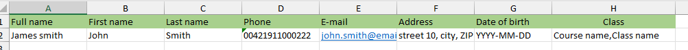
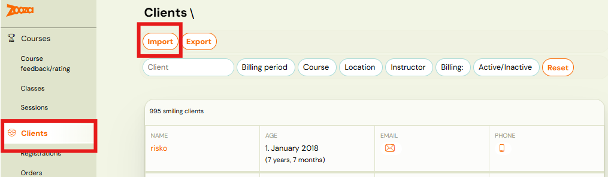
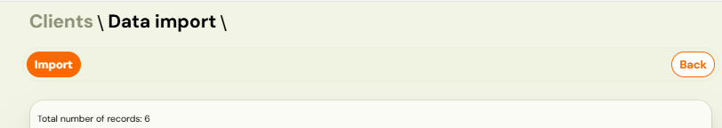
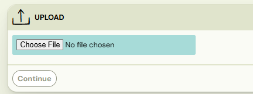
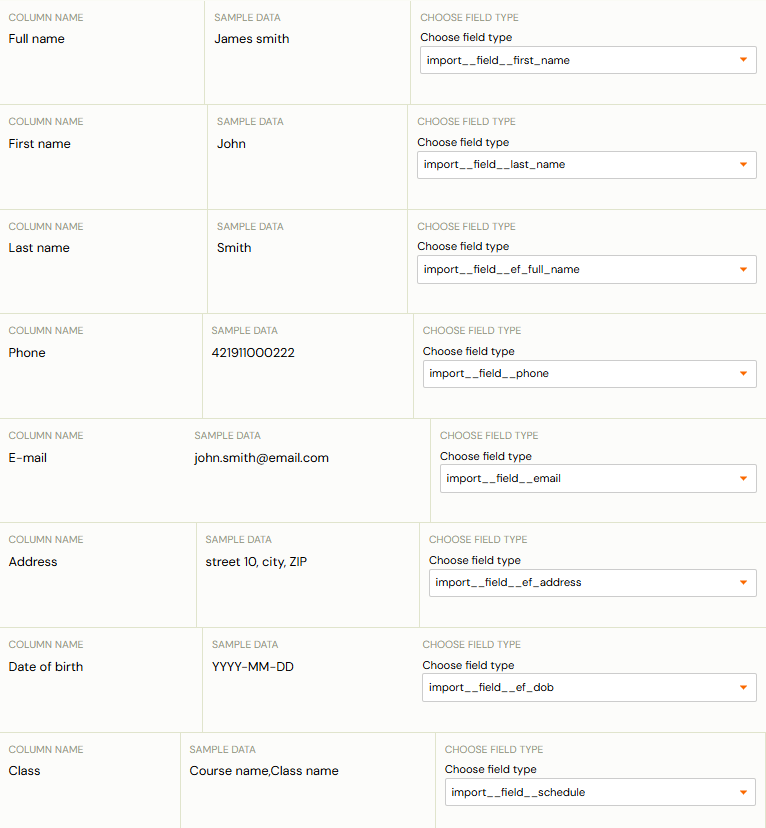
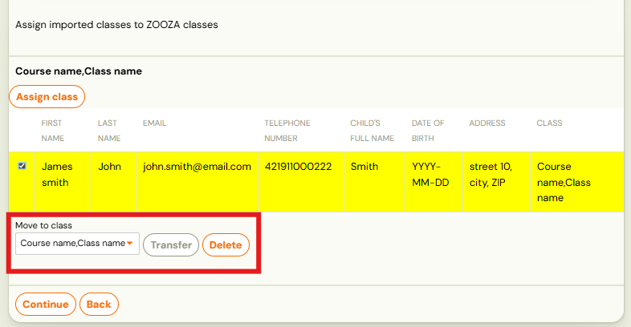
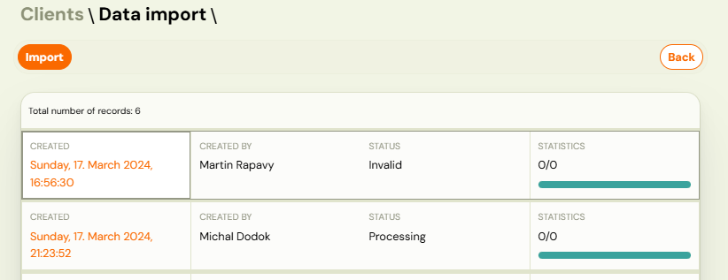

# Client import

When you are a new client, or if you need to move existing clients from one Zooza account to another, the Client Import feature can save you time.

Important: Before starting the import, make sure the required programmes and classes are already created in Zooza. Clients can only be imported into existing classes.

## Data preparation

1. Download the spreadsheet provided in this article.
2. Fill in all required fields as shown below

| Column name | Value | Note | Required |
|---|---|---|---|
| Full name | James Smith | For programmes where the attendee is different from the client (e.g., a child), enter the attendee’s name here. | Y |
| First name | John | First name of client | Y |
| Last name | Smith | Last name of client | Y |
| Phone | 00421377 | Use the format starting with 00 instead of + (e.g., 00421...). | Y |
| Email | jane.doe@example.com |  | Y |
| Date of Birth | YYYY-MM-DD | Use this date format exactly. | N |
| Class | name of required class | Must match the class name exactly as it appears in Zooza. | N |

The table in Excel will look like this:

Important! To successfully import your data, save the spreadsheet in .csv format. Other Excel formats will not work.

## Import to Zooza

1. In Zooza, go to the *Clients* tab in the menu and click *Import*.
 
2. Create a new import by clicking the *Import* button.
 
3. Upload the .csv file you prepared.
 
4. Map the spreadsheet headers to the corresponding Zooza fields (as shown in the example image) and click *Continue*.
 
5. If the classes already exist in Zooza, assign clients to the appropriate classes and click *Continue*.
 
6. Zooza will validate each row of your spreadsheet and notify you if any data is incorrectly formatted. You can then adjust your spreadsheet and re-import the file.

Notes:

1. If you do not assign a class, the client will be created in Zooza but no booking will be created.
2. You can perform a partial import from your spreadsheet to verify that you are importing the correct clients into the right classes.
3. Processing starts immediately after upload — there is no waiting period. You can track the real-time progress in the **List of Imports**.

## Import statuses

| Status | Meaning |
|---|---|
| **Processing** | Import is running. A progress bar shows how many rows have been processed. |
| **Done** | All rows were imported successfully. |
| **Partial** | Some rows had validation errors and were skipped. Valid rows were imported. Click **Process** to retry the skipped rows after fixing the source data. |
| **Failed** | The import worker encountered an error. Click **Retry** to re-dispatch the import. |

> If an import is stuck in **Processing** for more than a few minutes, use **Retry** to restart it.

## Assigning imported clients to blocks

**Blocks are assigned after the import, by hand.** This is deliberate rather than a gap: imported clients usually arrive in a mix of payment states — some paid in full, some mid-plan, some owing — and putting them all into a block automatically would attach the wrong money to most of them.

For each imported registration:

1. Open it and assign the block on the **Attendance** tab.
2. Apply the payment plan that matches where that client actually is.

Two things make it faster:

- **If most of a class shares the same terms**, apply a payment plan in bulk from the class detail and then fix only the exceptions.
- **Check attendance tracking is switched on** for the class first. If it is off, there is no attendance tab to assign the block on.

A few dozen clients is an afternoon. If you are importing hundreds across many classes — a franchise coming on board, say — tell us the shape of it before you start; there may be a better route than doing it one at a time.
