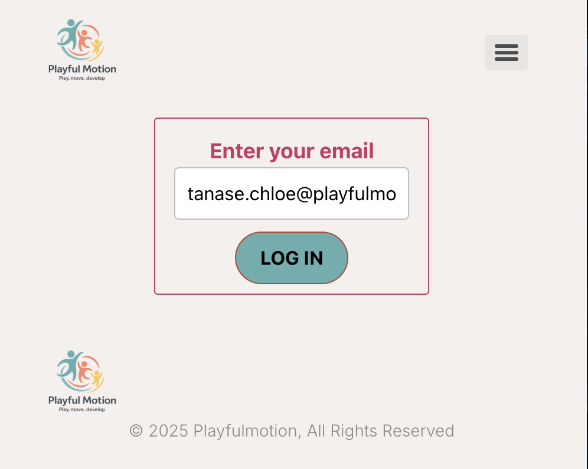
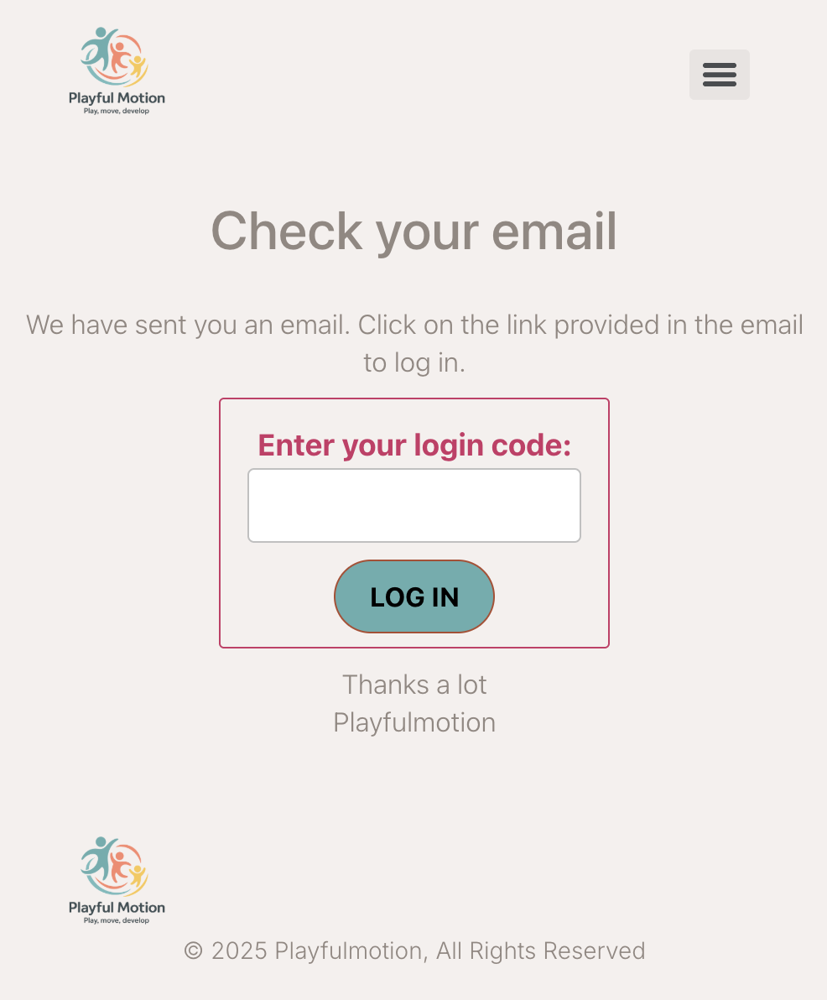
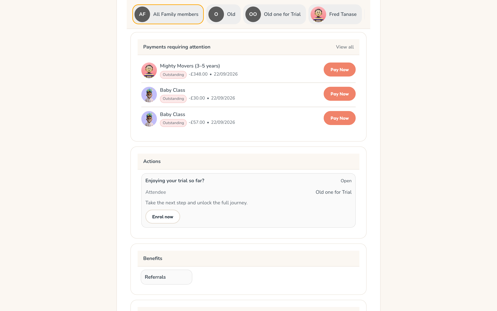
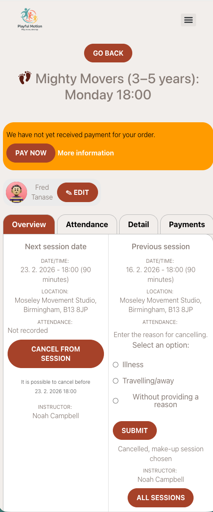
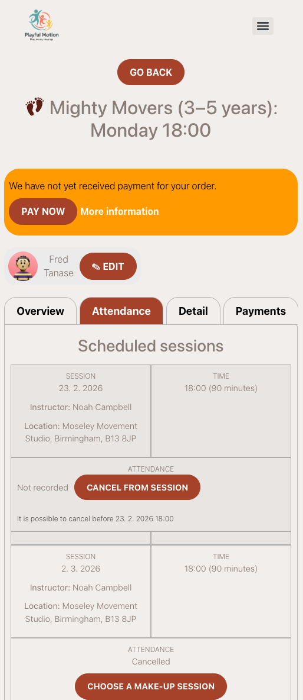
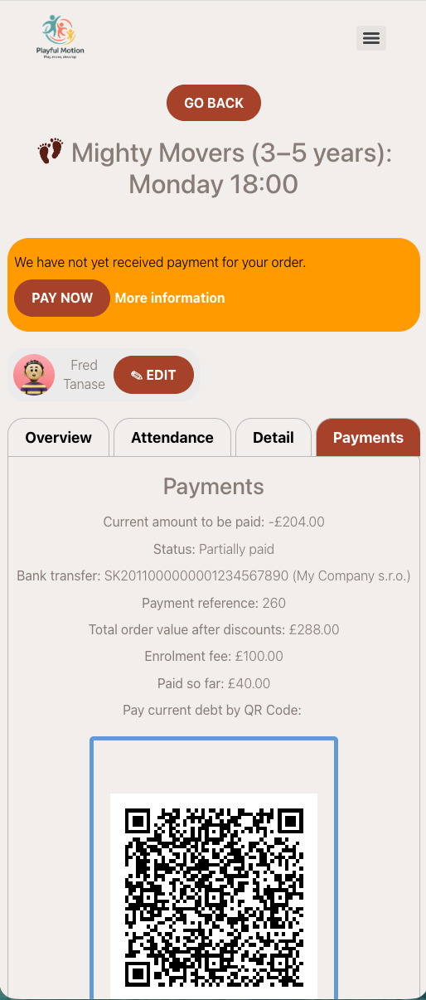
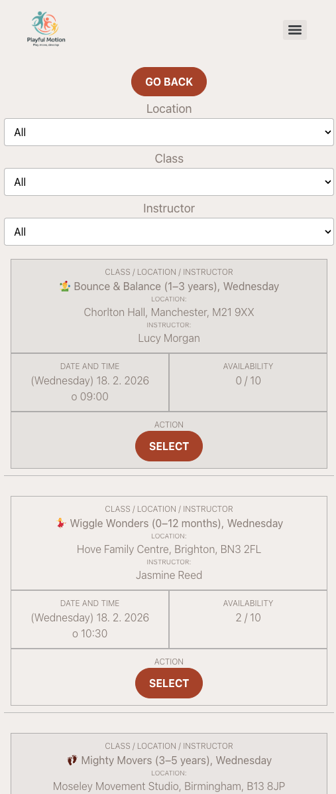
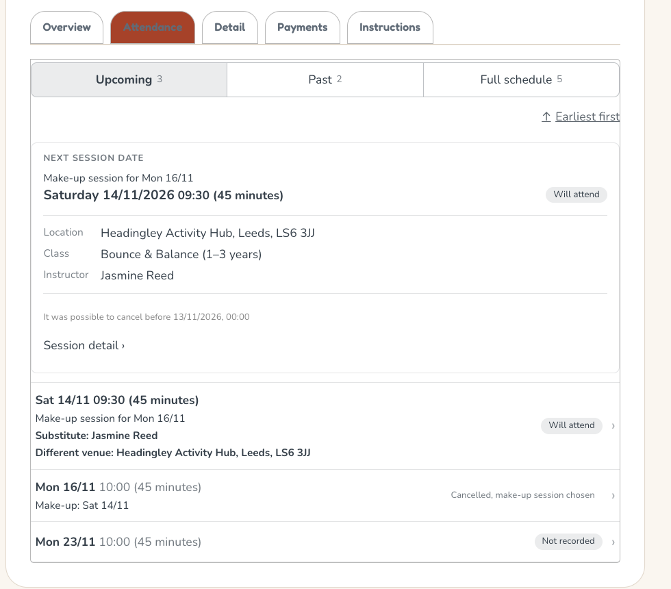
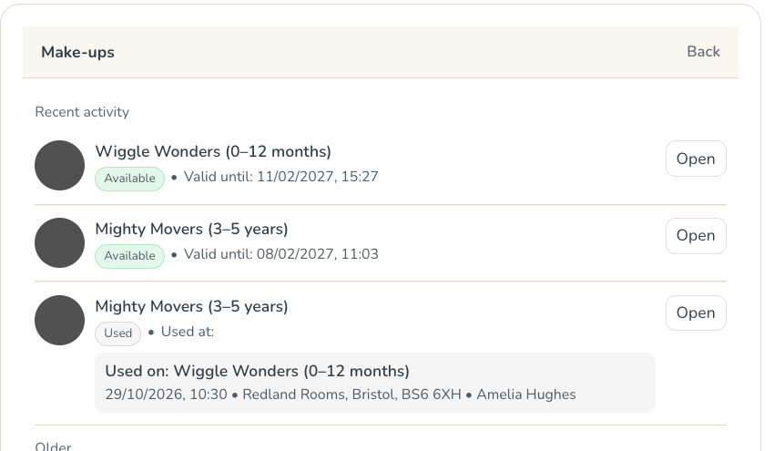
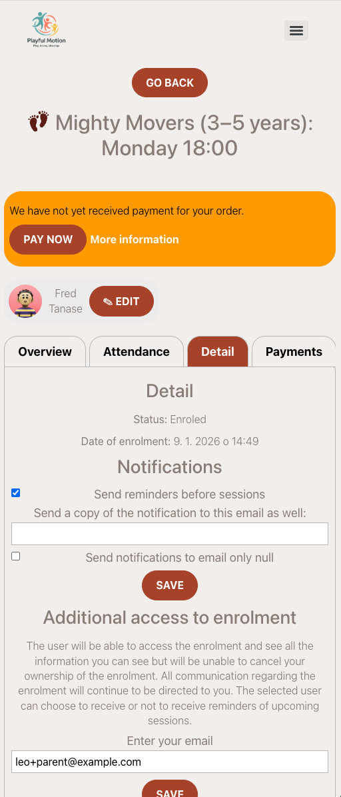

# Client Profile 101

The Client Profile is a self-service dashboard where clients manage their bookings, sessions, payments, benefits, and orders in one place. It works on both mobile phones and computers and does not require remembering any password.

> **For admins:** The Client Profile reduces support requests — clients can check payment status, find invoices, book make-up sessions, and view their benefits without contacting you.

## Logging in

1. The client opens the Client Profile URL (embedded on your website or sent via email).
2. They enter the email address used during booking.
3. They receive a **one-time login code** or a **secure login link** by email.
4. Clicking the link or entering the code logs them in automatically.

There is no password to create or remember. Each login sends a fresh email.

## 2. No passwords needed

> **Tip for admins:** Use the `WIDGET_PROFILE_URL` dynamic tag in your email templates to automatically insert the correct Client Profile URL for each client.

### Testing the profile without seeing your own data

The Client Profile URL is the same address for everybody — what a person sees
depends on who is logged in **in that browser**. So if you open a link you sent
to a client while your own client account is still logged in on that computer,
you see your own profile, not theirs. Two consequences worth knowing:

- **Test in a private window**, or log out first. Otherwise you are looking at
  your own bookings and payments and concluding that every client sees them.
- An unpaid order of yours — a leftover test purchase, a gift voucher you never
  paid for — then shows up as an outstanding payment, and it is easy to believe
  the whole customer base is seeing it. They are not: an outstanding item appears
  only in the profile of the client whose order it is. Delete obsolete test
  orders under **Orders** so they stop appearing in yours.

If you need to be certain what one client sees, ask support to check that
client's profile view rather than clicking the link yourself.

## Home page overview

Once logged in, the client sees their home page with:

- **Family members** — switch between children (or attendees) at the top.
- **Active and past bookings** — all bookings in one place.
- **Quick actions** — pay, book make-ups, view sessions.

### Between terms, the home page says so

When a client has nothing running — the summer gap, or the weeks between one term
and the next — the **Current programmes** card does not go blank. It says *"You have
no programmes running right now."* and offers **View your past programmes**, which
opens their booking history.

This matters because the previous behaviour read as data loss. A parent with four
finished bookings opened the app and saw the same generic *no data for this view*
message as somebody who had never booked anything, while their bookings sat one tap
away. For a seasonal business that was the normal state for months.

The card only appears for clients who actually have past bookings. A genuinely new
client, with nothing behind them, sees no card at all. Live since 2 September 2026.

### Switching between family members

If a client has multiple children enrolled, they can switch between them by clicking a name or avatar at the top. Some sections (like orders or family-level discounts) are shared and do not change when switching.

## Bookings and programme overview

Opening a booking shows the programme dashboard:

- **Upcoming sessions** — what is next.
- **Programme details** — key information about the programme.
- **Quick actions** — access to sessions, payments, and benefits.

## Sessions

In the sessions tab, clients can view:

- All scheduled sessions.
- Attended sessions.
- Cancelled or missed sessions.

The list stays up to date automatically. If the provider uses online sessions, a livestream link may appear here.

## Payments and invoices

In the payments section, clients can:

In the Attendance tab, you can view:
- See which payments are **unpaid** and which are **paid**.
- **Pay online** — open the unpaid item and continue to the payment gateway (if online payment is enabled) or view payment instructions (for bank transfer).
- **Download invoices or receipts** (if the provider enables invoicing).

The payment status updates automatically after payment.

## Make-up sessions

If a client cancels a session or misses it, and the provider allows make-ups, the client can:

1. See available make-up sessions in their profile.
2. Select a make-up session from the available options.
3. Confirm the make-up directly.

Make-up availability depends on real capacity — if no suitable session with space is available, the option does not appear. Clients receive email or WhatsApp reminders about available make-ups.

### What the parent sees on the Attendance tab

**Upcoming**, **Past** and **Full schedule** each carry a count, so a parent can see at a
glance how much of the term is left. **Earliest first** flips the order.

The next session opens in full, with its venue, class and instructor. Underneath it, the
cancellation rule in plain words — and once the deadline has gone it stays on screen in
the past tense, *"It was possible to cancel before 13/11/2026, 00:00"*, rather than
disappearing and leaving a parent wondering whether there was one. That sentence is yours:
it comes from the cancellation limit on the programme. See
[Cancellation limit settings](cancellation-limit-settings.md).

**A booked make-up appears twice, and both ends say so.** It sits on its new date labelled
*Make-up session for Mon 16/11*, and the session it replaces stays in the list reading
*Cancelled, make-up session chosen* with the new date beside it. Neither disappears, so a
parent who forgets which one they moved can see it from either direction.

**A substitute instructor or a changed venue is called out in bold on the row** — *Substitute:
Jasmine Reed*, *Different venue: Headingley Activity Hub*. A parent scanning the list sees
what is different about that one session without opening it.

### The make-ups a parent has, and what became of them

Each credit is **Available** or **Used**, and an available one shows **Valid until** with the
date and time it runs out — a make-up credit expires, and a parent who leaves it does lose
it.

A used credit shows what it was spent on: the class, the date and time, the venue and the
instructor. That is the line to point at when somebody says a make-up went missing.

> **The credit is named after the class it came from, not the one it was used on.** In the
> picture, a Mighty Movers credit was spent on a Wiggle Wonders session — which is normal
> wherever you let make-ups cross between programmes, and reads as an error if you are not
> expecting it. See [Can I restrict make-up sessions to the same programme only?](../faq/make-up-sessions-faq.md)

## Benefits

The Benefits section classes all "extras" in one place:

| Benefit type | What the client sees |
|---|---|
| **Make-ups** | Available and used make-up sessions (with history). |
| **Discounts** | Available and expired discounts. Some discounts are family-level. |
| **Entry passes** | Prepaid visit passes — remaining entries, expiration date, status. See [Entry pass — client view](entry-pass-client-view.md). |
| **Credits** | Prepaid credit balance, where and when credits were used. |

This helps clients answer their own questions: "Do I still have a make-up?", "How many entries are left on my pass?", "Where did my credit go?"

## Orders

The orders section shows:

- **Unpaid orders** — number and details.
- **Paid orders** — history of completed orders.

Clients can open an order to see its details, including items purchased, payment status, and entry pass entries.

## Sharing a booking

In the booking details, clients can share access with another person — for example, another parent, a grandparent, or an older child. The shared person receives:

- Notifications and updates related to the booking.
- Full access to all documents attached to the booking — files, videos, and URLs at any level (booking, class, programme, or session). They can view and download everything the original buyer can see.

> **For admins:** You can also set up shared access from the admin side. See [Client Management FAQ](../faq/client-management-faq.md) for details on giving a second parent access.

## My data & consents

Clients can view all consents and agreements they have ever given — including Zooza platform agreements and your company's own terms — in one place. Each entry shows whether they accepted or declined it, the version, and when it was given.

From this section, clients can also **Download PDF** to get a self-contained PDF summary of their full consent history on demand. The PDF includes the full text of each agreement alongside their response.

See [How clients view and download their consent history](client-consent-overview.md) for details.

## Bottom navigation menu

On mobile, a quick navigation menu at the bottom lets clients jump directly to a section (Bookings, Benefits, Orders) without scrolling.

## Related

- [Client Profile FAQ](../faq/client-profile-faq.md) — common questions about the Client Profile.
- Client profile dashboard — overview of the client-facing self-service profile.
- [Client Management FAQ](../faq/client-management-faq.md) — admin-side client management.
- [Entry pass — client view](entry-pass-client-view.md) — how clients see and use entry passes.
- [Customizing widgets](customizing-widgets.md) — embedding the Client Profile on your website.
