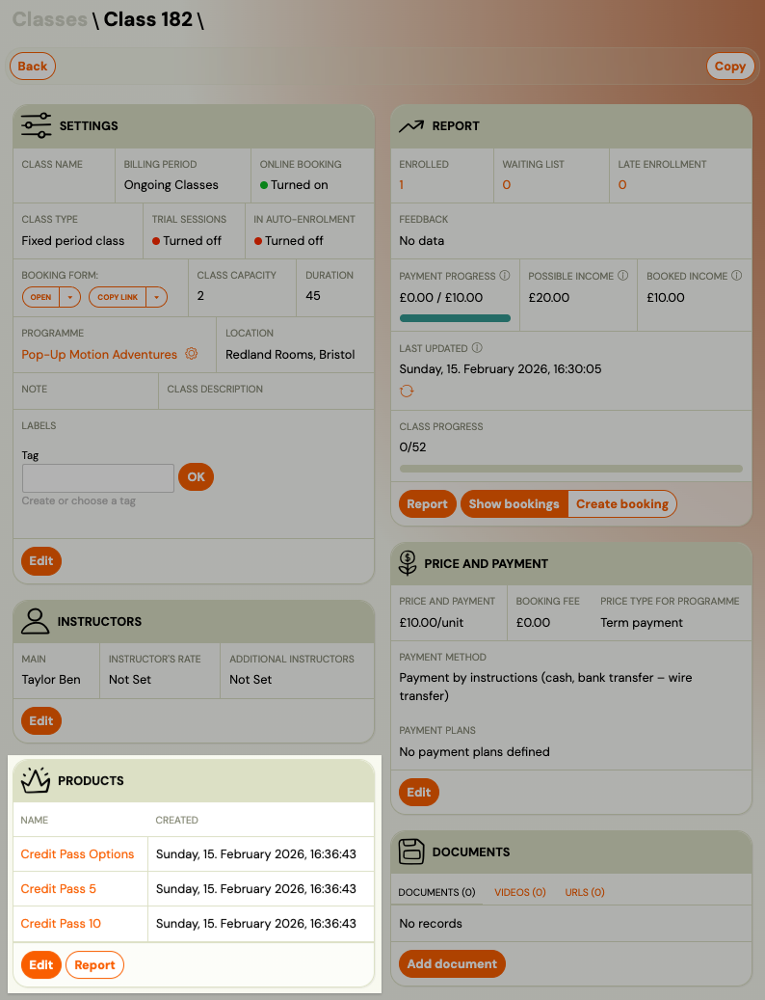
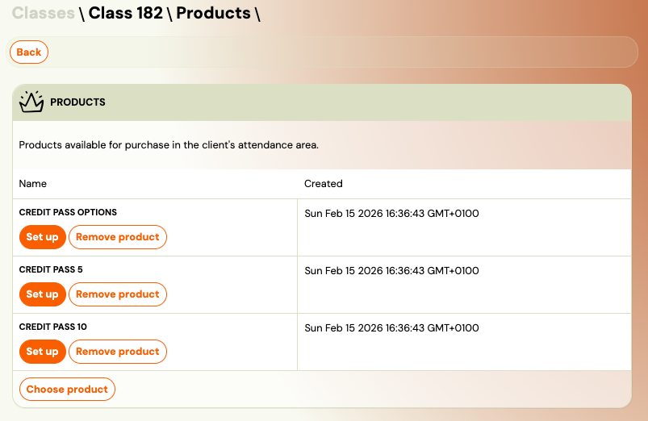
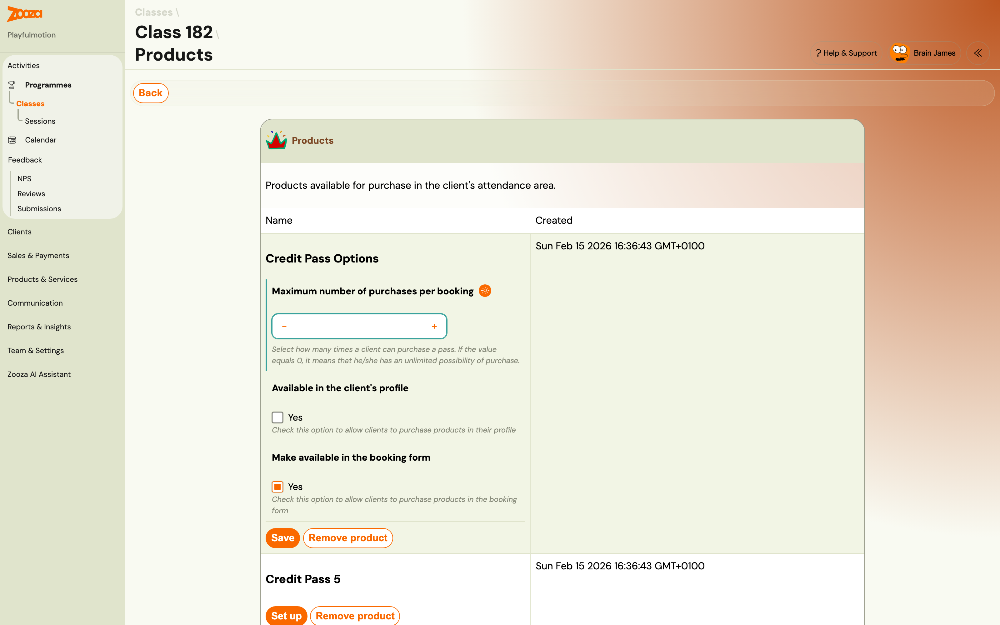

# Creating entry passes

Entry passes let clients prepay for a set number of sessions or a credit amount, which is then redeemed each time they book a session in a Pay-as-you-go programme. Entry passes are optional — without them, clients simply pay per session.

## Entry pass vs Prepaid credit

Zooza supports two types of prepaid products:

- **Entry pass** — A visits-based pass. The client purchases a fixed number of entries (e.g. 10 sessions). Each time they book a session, one entry is deducted.
- **Prepaid credit** — A money-based pass. The client purchases a credit amount (e.g. 50 EUR). Each time they book a session, the session price is deducted from their credit balance.

Both types work the same way in the booking flow. Choose based on whether you want to sell by number of visits or by monetary value.

## Three words that get mixed up

Rebuilt in October 2026. Before anything else, these are three different things:

| Word | What it is |
|---|---|
| **Entry pass** | The sellable thing you configure once — "Studio pass" |
| **Pack size** | One size of it: 3, 5 or 10 entries, each with its own price and expiry |
| **Pass** | A single admission. One entry, held by one client. |

**A pack is not a container.** Buying a 10-pack creates ten independent passes. Each carries its own share of the price and its own expiry date, and after the purchase nothing links them except the order they came from.

That is why a client's balance is simply a count of the passes they still hold: unused, unexpired, and not cancelled. A screen showing "10 entries" is naming the pack they bought, not what is left.

## Creating an entry pass

Go to **Entry passes** and click **New entry pass**. Give it a name — that is all the first screen asks for. Pack sizes, where it sells and whether it renews are set on the screen that follows.

> **The old route is closed.** Entry passes used to be built as an item inside a product, under **Items for sale**. New ones cannot be created that way any more. Passes you already sell through the old route keep working and stay editable — nothing you have built needs redoing.

The pass owns a product behind the scenes. You will see that product in the products list, marked as managed by the entry pass: *"Sold here because the entry pass says so. Change it on the pass."* Price and pack sizes are edited on the pass; how clients may pay is still set on the product.

### Pack sizes

*One entry pass, sold in several pack sizes.* Add one per size you want to sell, each with its own **Entries**, price and expiry. A pass with no pack sizes cannot be bought, and archiving every size takes it off sale without deleting anything.

### Sold on

A pass attached to a programme is offered on **every class of that programme, including classes added later**, so you do not have to revisit it each term. You can also cap **Maximum purchases per client**.

Two rules worth knowing:

- **Only open programmes can sell an entry pass.** A pass is spent per session, so a programme booked for its full duration has nothing to spend it on. If you attach one anyway, Zooza tells you to remove it or change how the programme is booked.
- **A pass is spent on any programme, not only the ones it is sold on.** Where you sell it controls where it can be *bought*, not where it works.

> This is the only place the attachment is set. The programme's own Products tab shows the pass but will not edit it, so the two can never drift apart.

### Renewal

A renewing pass **re-buys itself on a schedule**: each cycle issues a fresh pack and bills for it like any other purchase. The cadence comes from a payment plan, and one plan can serve several passes — a pass carries one renewal plan at a time.

Billing is either on a **fixed day of the month** or on the **anniversary of the purchase**.

- **No renewal plan** — the pass is bought once and runs until its passes are used or expire.
- **Switched off** — sold as a one-off until you switch it back on.
- **Removed** — passes already issued are unaffected; no further cycles are billed.

> **It pauses itself.** A client who falls behind on payment stops receiving new packs, rather than quietly accumulating passes they have not paid for.

> **It is a payment plan, not a subscription.** Zooza uses "subscription" for something else, and calling this one will send you to the wrong screen.

## Who actually holds the pass

**The buyer holds the passes — not the child.** A pass is attached to the person with the login, which for a children's programme is the parent. The child attending is an attendee and never holds one.

In practice the parent spends their own passes against whichever attendance they choose, including each of their children's. One parent, one pool of passes, however many children.

## Assign pass to a class

After creating the entry pass product, assign it to the relevant programme or class.

1. Go to the **Programme** → **Class** → **Select Product**.

   

2. Choose the entry pass product you created.

   
3. Click **Save**.

You can assign multiple pass types to the same class. For example, you might offer both a 5-session pass and a 10-session pass.

### Product settings per class

Click **Set up** on the product row to open its settings for this class:

- **Maximum number of purchases per booking** — how many times one client may buy
  this pass. **0 means unlimited**, which is what an empty field amounts to.
- **Available in the client's profile** — clients can buy the pass from their
  profile once they have a booking.
- **Make available in the booking form** — the pass is offered while the client
  is registering.

The two availability checkboxes are **independent**. Tick one, the other, or
both — as the picture above shows, this product is sold in the booking form only.

## Two-product setup for dual availability

**You usually do not need one.** The two checkboxes above are independent — tick
both on the same product and it is offered in the booking form and in the client
profile. One product, one price, one place to edit it.

Create a second product only when you want the two places to differ: a different
price in the booking form than in the profile, a bundle offered only during
registration, or a pass you sell at the desk but do not advertise to clients.

### Example: 5 EUR and 10 EUR passes

To offer two pass values in both places, create **two** products — a 5 EUR pass
and a 10 EUR pass — and tick both availability checkboxes on each. You do not
need four.

## Client perspective

After enroling for a Pay-as-you-go programme, clients can:

1. Purchase an entry pass from their profile (under **Orders** and in the detail of a booking).
2. See their credit balance or remaining entries on their profile home page.
3. Book sessions — the pass is automatically redeemed when they book.
4. If they cancel the session, the entry or credit is returned.

For a detailed walkthrough of how clients see and use entry passes, see [Entry pass — client view](entry-pass-client-view.md).

## Related guides

- [Pay-as-you-go programme](pay-as-you-go-programme.md) — How to set up the programme type that uses entry passes.
- [Linked classes](linked-classes.md) — Use one entry pass across multiple linked classes.
- [Selling products during booking](selling-products-during-booking.md) — How to offer products in the booking flow.
- [Entry pass — client view](entry-pass-client-view.md) — How clients see and use entry passes in their profile.
- [Pay-as-you-go FAQ](../faq/pay-as-you-go-faq.md) — Common questions about entry passes and Pay-as-you-go.
