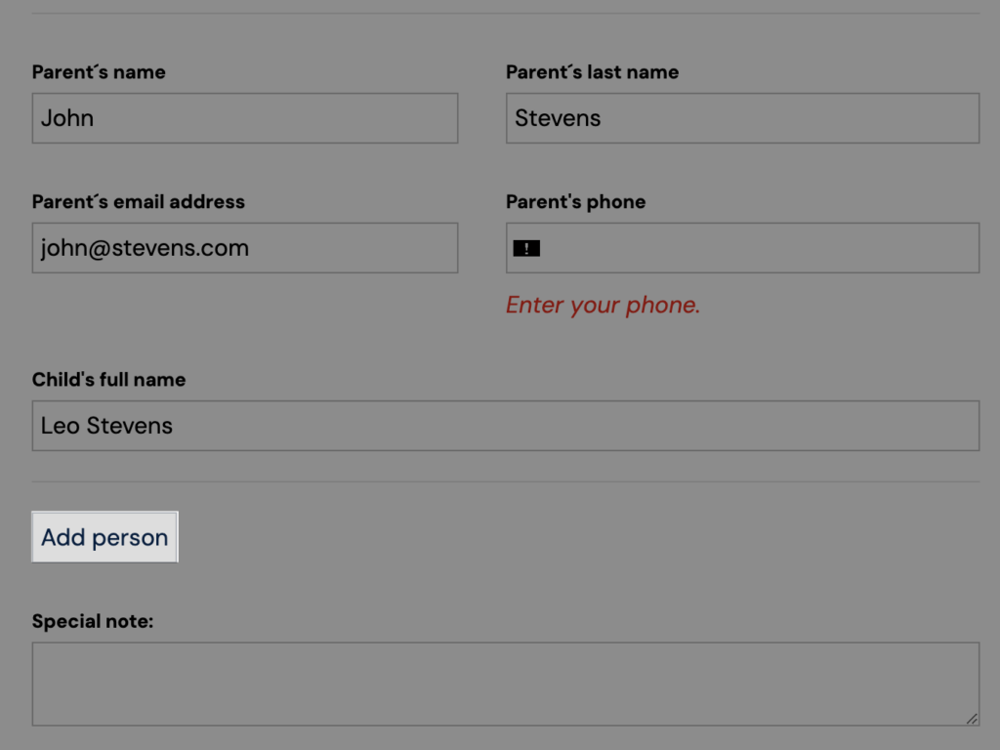
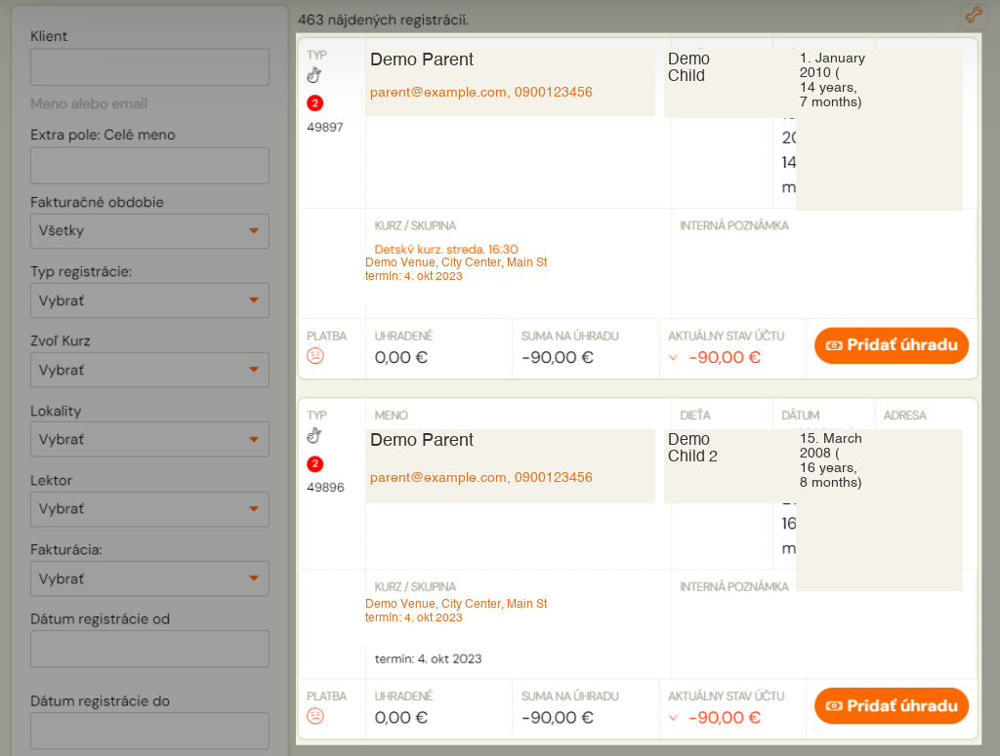
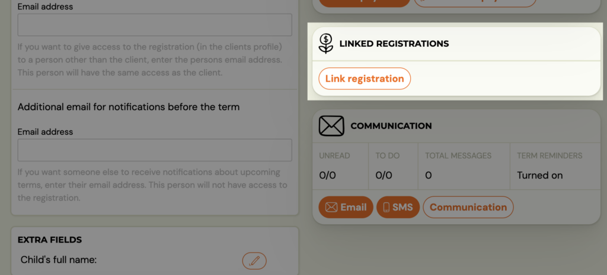
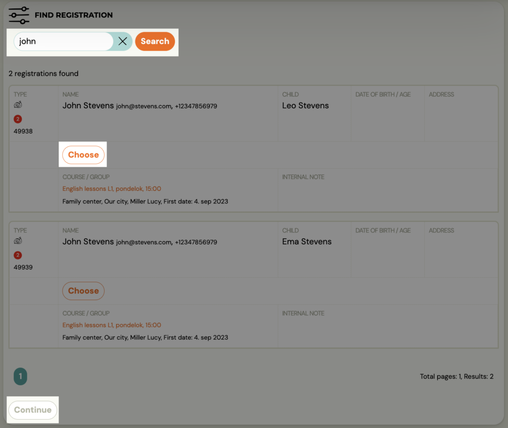
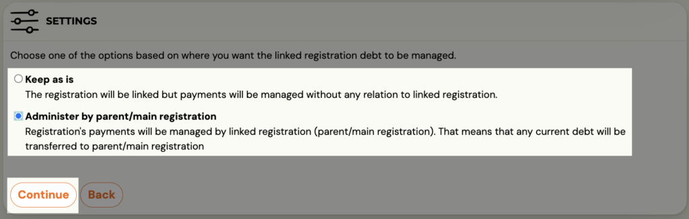
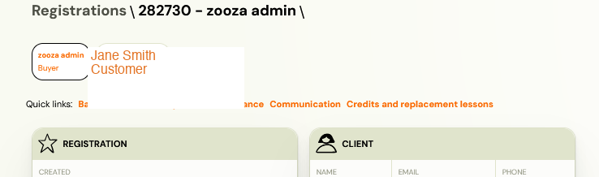
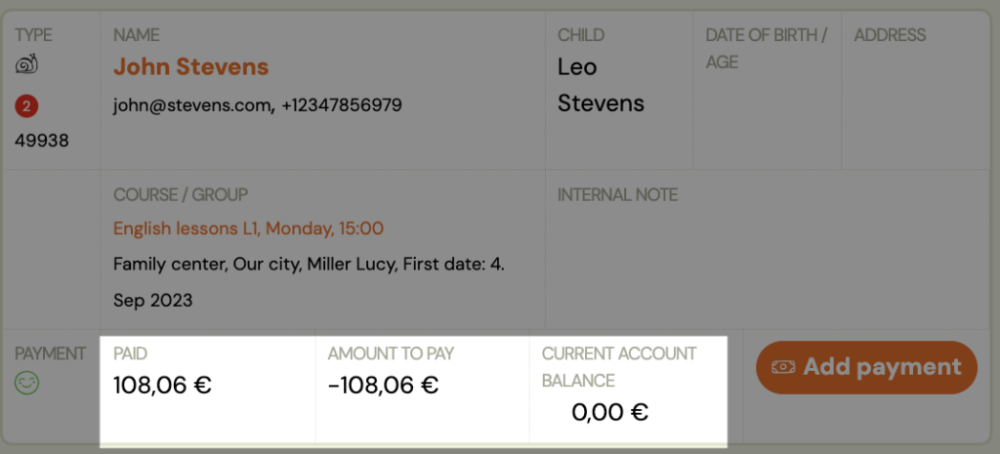
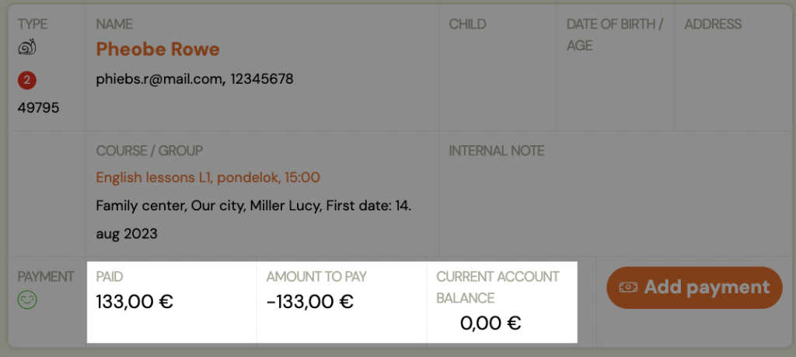

# Linked bookings

If you are an organisation that offers a wider range of programmes for children and are used to having siblings enrolled, or your clients are enthusiasts and attend multiple programmes on their own at once, there is a very useful functionality – linked bookings.

With linked bookings, you essentially bundle payments for two or more bookings. For example, if a parent has 2 children and they are both registered with you. Or if an adult client takes two programmes at the same time.

With linked bookings, you allow the client to make only one linked payment to one variable symbol and you can keep your payments in order.

## How does it work?

If the parent fills in the booking form fields for both children at the same time, i.e. uses the *Add person* option when filling in the booking form, the two bookings will automatically be linked and related.
How to set up the Add Person option and where to set it to link payments automatically can be found in this [manual](../faq/booking-faq.md).

However, if you register your children or yourself in two different classes/programmes and therefore fill in two booking forms, the system will not combine such bookings. However, you can pair them manually and they will continue to function as related.

## Link related bookings

So let’s see how we can link related bookings and set up a common payment for them.

1. Choose one of the bookings that you want to have as the main one (e.g. parent or older child, or simply one of the two), i.e. the one that will receive payments for both/all linked bookings.
 
2. On the booking card for that booking, you will find the *Linked Bookings* tile
3. Click on *Link booking*
 
4. Find the booking you want to link to this booking
5. Confirm the selection with the *Select* button
6. Click *Continue*
 
7. Select one of the options for how you want to link the booking
8. *Leave as it is* –link bookings but keep payments separate. Thanks to the link, you can quickly find your sibling’s booking, but the payments remain separate on each booking
9. *Manage parent/main booking* – links booking together with payments. It creates a debt on the master booking in the sum of the values of the two or more linked bookings, and credits the linked bookings with the payment.
 

If we have chosen the second option, it will create a debt on the main booking in the sum of the values of both or more linked bookings, it will credit the linked bookings with the payment.
Once successfully linked, each booking clearly indicates which is the main and which is linked, and you can easily switch between them.

The parent/client pays for both/multiple programmes only once using one variable symbol. They can see the payment information in their profile.

---

## Cancelling or deleting the main booking

A main booking cannot simply be removed — the others would be left pointing at nothing.
Until late October 2026 Zooza just refused, which meant an admin who wanted to cancel one
place was told "no" with no way forward on the screen they were on. Now it asks.

Cancel or delete the main booking and you get **Cancel a root booking** (or **Delete a
root booking**) with one question: **What should happen to the linked bookings?**

| Choice | What happens | When you want it |
|---|---|---|
| **Disband the link** | The other bookings stay and **each pays for itself** | The ordinary case. A parent cancels their own place, the children carry on |
| ***X* becomes the root booking** | Another booking in the group takes over as the main one | The family keeps paying together, just through someone else |
| **Remove the whole group** | Everything in the group goes | You are closing out the whole family |

Then it asks about the money: **Remaining balance of this booking** — **Leave it on this
booking**, or **Move the remaining balance to** one of the others. Where it cannot be
moved anywhere, it says so plainly and leaves it where it is.

You are shown all of this *before* anything is written, so you can see who else is
affected and what money moves rather than finding out afterwards.

> **Scheduling the cancellation for a future date does not delay this part.** The links
> and the money change **the moment you schedule it** — only the status waits for the
> date. And **revoking the cancellation later does not restore the links.** If you are
> unsure whether the family is really leaving, do not schedule it yet.

Two messages you may hit:

- **"The linked bookings changed since the check. Choose again."** Somebody altered the
  group while you were deciding. Harmless — make the choice again against the current
  group.
- **"This booking has a scheduled status change, so its links can't change until it runs
  or is revoked."** Revoke the scheduled change first, or wait for it.

> **If you remember this being far more work, that is why it changed.** For a while the
> only route was unlinking every booking and its products one at a time before you could
> touch the main one. The stricter rules behind that were deliberate — admins were
> deleting bookings that managed other bookings' money and leaving payments unpairable —
> but the way out of them was missing. This is it.
