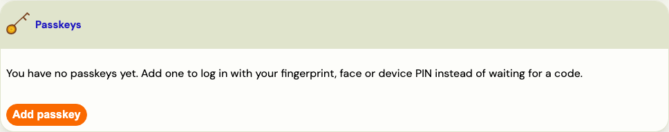
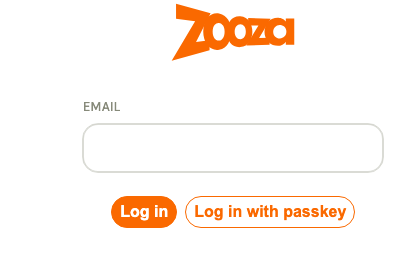
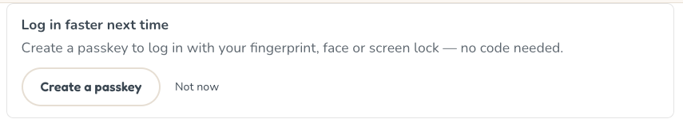

# Log in with a passkey instead of a code

A passkey logs you in with your fingerprint, your face or your device's screen lock
instead of a one-time code. You stop waiting for an email, and there is nothing to
type.

**This is still not a password.** Zooza has never had passwords and still does not.
A passkey is a key your device keeps and unlocks with your fingerprint or face; the
secret part never leaves the device and is never sent to Zooza. It also only works on
the exact website it was made for, so it cannot be handed to a fake login page.

**One-time codes keep working everywhere, for everyone, always.** A passkey is a
shortcut, never a requirement. Nobody can be locked out by it.

Both you and your clients get this: you in the Zooza app, they in the booking form
and their client profile.

## Set up your own passkey

**After a login code.** The next time you log in with a code, Zooza shows a full-screen
offer — *Sign in faster with a passkey*. Press **Set up passkey**, confirm with your
fingerprint, face or device PIN, and it is done.

The other two buttons do different things, and the difference matters:

| Button | What happens |
|---|---|
| **Set up passkey** | Creates the passkey and takes you into the app |
| **Not now** | Takes you in and **asks again** at your next code login |
| **Keep using codes** | Takes you in and **stops asking** |

**Any time, from your profile.** Go to **your name (top right) → My profile** and find
the **Passkeys** card.

Press **Add passkey** and confirm. If you pressed **Keep using codes** earlier, this is
how you set one up anyway — the offer screen does not come back on its own.

> The offer only appears if you have no passkey for that address yet. One is enough —
> your password manager carries it to your other devices.

## Log in with it

On the login screen, two things change once you have a passkey:

- **Click into the email field** and your browser offers the saved passkey straight
  away. Pick it and you are in.
- **Or press Log in with passkey** and skip the email entirely.

You land exactly where a code login lands. Your role, your company and your
permissions are unchanged — the passkey only replaces the code.

## Your clients get the same thing

**Where they are offered one.** After a client logs in with a code, a small card appears
in their profile. It never blocks a booking.

> **Careful — Not now means something different here.** In the client profile, **Not now**
> stops the offer for good. In your admin app, **Not now** means "ask me again" and
> **Keep using codes** is the one that stops it. If a client says they dismissed it by
> accident, they can still add one from their profile.

**Where they can use one.** Everywhere they log in today:

- the **log-in step of the booking form**, where they enter an email or phone number —
  they stay on the page and keep everything they already picked;
- the **client profile login**.

In both places the browser offers the saved passkey as they click into the field, and
there is a **Log in with a passkey** link as well.

**Where they manage them.** In their client profile, under **More → Passkeys**. They can
add, rename and delete, exactly as you can.

**Nothing changes for guests.** **Continue as guest** works as before, and so does every
code and magic link.

## What a passkey is tied to

**A passkey only works on the web address it was created on.** This is what makes it
unphishable, and it is behind almost every question you will get.

**For you and your team**, that address is your region's app:

| Your region | Your passkeys live on |
|---|---|
| Europe | `zooza.app` |
| United Kingdom | `uk.zooza.app` |
| Middle East and Asia | `asia.zooza.app` |

A passkey made on one does **not** work on another — they are separate systems, not
just separate addresses. If you work across regions, make one on each.

**For your clients**, it is the website address saved with your widget, in
**Team & Settings → Publish**. Two consequences worth knowing before someone reports a
fault:

- **If you change that address, their passkeys stop working.** They are not deleted —
  they simply are not offered any more. Clients fall back to a code and are offered a
  new passkey on the new address. Change the address back and the old ones work again.
- **If your widget's address is not a real website address**, passkeys are quietly off
  for your clients and codes work as before. Nothing breaks, but nobody is offered one.

**Running a network?** Companies whose widgets sit on one shared address share the
passkey. A client who creates a passkey on the central website is signed in by the
same passkey on a branch's widget, once they are that branch's client too. They never
need a second one.

## Across devices

**Zooza does not sync passkeys — your password manager does.** iCloud Keychain, Google
Password Manager, 1Password and the rest carry the passkey to the other devices signed
into the same account.

If you mix ecosystems — say Google Password Manager on a Windows laptop and Safari on
an iPhone — the passkey may not travel. Log in with a code once on the new device and
create a second passkey there. There is no limit on how many you have.

## When the passkey option does not appear at all

This is normal in several situations, and in all of them codes work as usual:

- **An old browser**, or any browser without passkey support.
- **A page that is not secure** (`http://` rather than `https://`).
- **The widget sitting inside a frame.** Some website builders wrap an embedded widget
  in an iframe. Zooza detects it and shows code login only.
- **While you are viewing Zooza as somebody else** during a support session. You can see
  their passkeys but cannot add, rename or delete one — only the account holder can.

## The email everyone gets

**Every new passkey triggers a security email** — *A new passkey was added to your
account* — naming the passkey, the date and the IP address, with a link to manage them.

- **You and your team** get it from Zooza.
- **Your clients** get it from you — your sender address and your branding.

It is a security notification, so it is always sent and cannot be switched off. If
someone receives one they did not expect, they should delete that passkey immediately
and tell you.

## Removing a passkey

In **My profile → Passkeys** (or, for a client, their profile), each one shows its name,
when it was created and when it was last used. **Rename** relabels it; **Delete passkey**
removes it.

**Deleting never locks anybody out.** The one-time code is still there. Delete a passkey
when a device is lost, sold or handed on.

## What a client is telling you when they quote an error

These come straight from the login screen, so the wording will match what they send you.

| What they see | What it means | What to tell them |
|---|---|---|
| *Passkey login isn't available here.* | Passkeys cannot run on this page — an old browser, a frame, or a widget address that cannot carry them | Log in with a code; nothing is wrong with their account |
| *This passkey can't be used on this website.* | The passkey belongs to a different address — usually your widget address changed | Log in with a code, then create a new passkey when offered |
| *We don't recognise this passkey.* | Zooza has no such passkey for this website, or they are not yet a client of this particular company | Log in with a code once; the passkey works afterwards |
| *The passkey request has expired.* | They left the prompt open too long | Try again |
| *We couldn't verify your passkey.* | The check failed | Try again, or log in with a code |
| *This passkey is already saved to your account.* | They are adding a passkey the device already holds | Nothing to do — the existing one works |

If someone simply cancels the fingerprint or face prompt, nothing is shown at all and
the code login is still sitting there. That is deliberate.

## Related

- [Login and Account FAQ](../faq/login-and-account-faq.md) — codes, login addresses and what to check when nothing arrives
- [Client Profile 101](client-profile-101.md) — what parents see and do in their profile
- [Client Profile FAQ](../faq/client-profile-faq.md) — common client login questions
- [Booking Widget FAQ](../faq/booking-widget-faq.md) — the log-in step in the booking form
