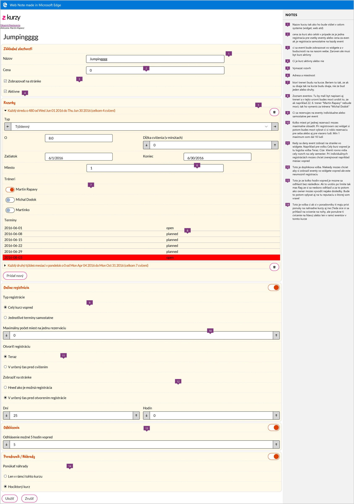
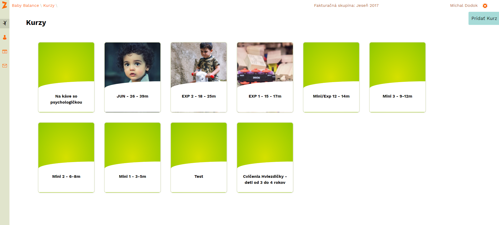
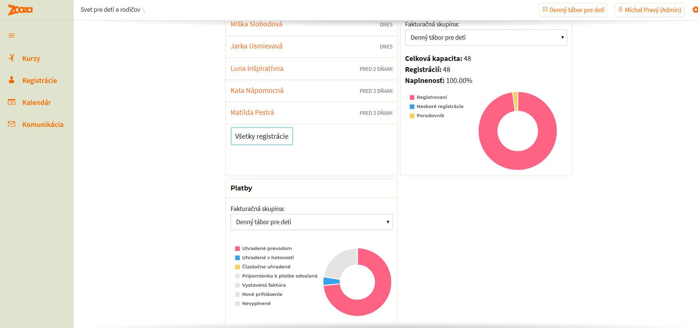

# Zooza through the years

A cross-section of what the app looked like at each stage, and of how releases
were made — which changed more than the screens did.

> **Draft, not published.** This page is in the repository but not on the help
> centre. It stays that way until the picture set is complete and we have
> decided who it is for.

---

## Where the facts come from

Two sources, and they cover different periods, so the page is honest about
which is which.

- **2016 – 2020: pictures only.** The app repository begins on **21 November 2020**;
  nothing before that is in version control. For those years the screenshots *are* the
  record — which is why the archive behind this page matters more than it looks.
- **2020 – today: the repository.** Release names, dates and the shape of the
  work are read out of git, not remembered.

---

## Why it changed

There is no grand plan behind the shape of this timeline, and it would be dishonest
to write one in afterwards.

**Zooza grew as its clients' demands grew.** A school asked for something, it got
built, and the next school asked for the thing after that. The invoicing system in
2022 and the WhatsApp work in 2025 are both in the list for the same reason: somebody
running classes needed them and said so.

**The design changed to keep up with the devices it was used on.** The screens below
are not a sequence of redesigns for their own sake. Each one is the product fitting
itself to how people actually opened it — and from about 2019 that increasingly meant
a phone in one hand, in a hall, between sessions.

**And new possibilities opened new work.** Online payments, direct debit, the shop,
and most recently running the business by talking to it. None of those were on anybody's
roadmap in 2016 because none of them were things you could reasonably do.

So read the eras below as a record of what was being asked for at the time, not as a
plan being executed.

---

## The eras

### July 2016 · before it was even called Zooza

The product was **z kurzy**, in pink. One long form held everything a course needed:
basic properties, schedules, online registration, cancellations, waiting list and
make-ups.

What makes this particular picture worth keeping is that it is **annotated**. Somebody
opened it in Edge's Web Note and wrote fourteen numbered notes explaining what each field
was for — why the price field means one thing for a whole-course booking and another when
each session is sold separately, what the cancellation deadline is really protecting, what
"offer make-ups" should and should not reach. It is the only surviving record of the
reasoning, not just the result.

And the reasoning holds up. Note 14 asks whether a make-up may be taken in any course or
only this one. That is, word for word, a setting in the product today.

### October 2017 · the name and the Z arrive

Fifteen months later the pink is gone and the orange **Z** is in the corner, where it
still is. Courses are tiles with photographs. The header already names a **billing
period** — *Jeseň 2017* — a concept that has never left.

### 2019 · the look we still have

The sage-green sidebar and the orange wordmark arrive, and the app stops changing its
appearance every year. The menu is four items — Kurzy, Registrácie, Kalendár,
Komunikácia — against today's dozen, which is a fair measure of how much the product has
since taken on.

The dashboard counts capacity, registrations and occupancy, and splits payments by how
they arrived. Those are the questions the Reports section answers now, with more
arithmetic behind them.

### 2020 – 2022 · named releases, a few a year

Versions were planned in Jira and shipped as events, each with a name that said
what it was for. The commit messages still carry the release report links.

| Date | Version | What it was called |
|---|---|---|
| Dec 2020 | 2.5.3 | Servisný release Leto 2020 |
| Jan 2021 | 2.5.4 | Online platby |
| Apr 2021 | 2.5.5 | Eshop — nehmotné veci |
| Jul 2021 | 2.5.6 | Fixy, BabyBalance web a Book 1 |
| Aug 2021 | 2.5.7 | Fixy a drobné veci |
| Sep 2021 | 2.5.8 | Refundácie a automatické platby |
| Oct 2021 | 2.5.9 | Presúvanie registrácií |
| Nov 2021 | 2.5.10 | Drobné fixy |
| Jan 2022 | 2.5.11 | Fakturačný systém |

Read down the names and the product's priorities are obvious: online payments
first, then the shop, then refunds and automatic payments, then invoicing. Each
one is a quarter of work landing at once.

### 2023 – 2024 · release branches

Jira version names stop; the work moves onto `release-*` branches merged into
main. **2.6.7** and **2.6.71 Preklady** in 2023, then **2.8** (April 2024),
**2.9** (May 2024) and **3.0** (August 2024). Three releases in a year instead
of one a quarter.

### 2025 · four releases, each with a theme

**3.4** (January), **3.5** (March), **3.6** (June), **3.7** (August). The
feature branches merged into 3.7 name themselves: WhatsApp, the course wizard,
Ecomail.

### 2026 · continuous, and specified before it is built

**3.8.2** lands in April and **3.8.3** in May, and then the numbered release
largely stops being the unit. Work is written as a spec first, built, and
shipped when it is done. A changelog entry is drafted per spec rather than per
release — the **Changelog** page in the app is the customer-facing end of that.

**The clearest measure of the shift is the volume of work landing in main:**

| Year | Commits on main |
|---|---|
| 2020 | 3 |
| 2021 | 10 |
| 2022 | 77 |
| 2023 | 156 |
| 2024 | 581 |
| 2025 | 573 |
| 2026 | 2 217 *(and the year is not over)* |

> **A caution about that table.** Commits measure activity, not value, and they
> are affected by how people commit as much as by how much ships. The 2020 and
> 2021 numbers are low partly because the repository was new. Read the curve,
> not the figures.

---

## What the archive holds

The pictures above come from a set Michal kept over nine years, by date:

`2016-07` · `2016-09` · `2017-02` · `2017-10` · `2019-09` · `2020-01` · `2022-06` ·
`2022-09` · `2023-03` · `2023-12` · `2024-12` · `2025-08`

Seventy-six files, including two presentations and a document of change notes. Only a few
are used here; the rest are the raw material for the eras this page still treats briefly.

**What the repository cannot tell you is who asked.** It records that invoicing
shipped in January 2022; it has nothing to say about the school that could not issue
a document their accountant would accept. That half of the story lives with the people
who were there, which is why *Why it changed* above is written as one honest paragraph
rather than a reason invented for each era.

If a particular year is worth drawing out properly, the pictures for it are already
in the archive and the dates are already in git. What it needs is the one thing neither
holds: the name of the problem somebody had that month.
