# Zooza through the years

Ten years of screens, side by side, with what each one could do at the time — and
why the product ended up shaped the way it is.

> **Who this is for.** Anyone who wants to know why Zooza works the way it does —
> a new colleague, a franchise partner, or a client who has been with us long enough
> to remember an older screen. It is a record, not a guide: nothing here tells you
> how to do anything.
>
> Some screenshots are of the Slovak app, because for the first seven years that was
> the only app there was. Names and figures belonging to real companies have been
> blurred out.

---

## Why it changed

There is no grand plan behind the shape of this timeline, and it would be dishonest
to write one in afterwards.

**Zooza grew as its clients' demands grew.** A school asked for something, it got
built, and the next school asked for the thing after that. The invoicing system in
2022 and the WhatsApp work in 2025 are both in the list for the same reason: somebody
running classes needed them and said so.

**The design changed to keep up with the devices it was used on.** The screens below
are not a sequence of redesigns for their own sake. Each one is the product fitting
itself to how people actually opened it — and from about 2019 that increasingly meant
a phone in one hand, in a hall, between sessions.

**And new possibilities opened new work.** Online payments, direct debit, the shop,
and most recently running the business by talking to it. None of those were on anybody's
roadmap in 2016 because none of them were things you could reasonably do.

So read the eras below as a record of what was being asked for at the time, not as a
plan being executed.

---

## What things got called

The vocabulary moved as much as the screens did, and it is the quickest way to date a
screenshot. Everything in this table is read off the left-hand menu of a picture
further down this page.

| Screen dated | The thing you sell | The group that meets | One meeting of it | Who teaches it |
|---|---|---|---|---|
| Oct 2017 | *Kurz* | *Skupina* | *Termín* | — |
| Jun 2022 | *Kurz* | *Skupina* | *Termín* | *Lektor* |
| Dec 2023 | Course | Group | — | Lecturer |
| Dec 2024 | Course | Group | Lesson/Event | Lecturer |
| Aug 2025 | Course | **Class** | **Session** | **Instructor** |
| Nov 2026 | **Programme** | Class | Session | Team |

Two things are worth noticing. The English names of 2023 are direct translations of the
Slovak ones; the names of 2025 are not translations of anything — they are the words
the customers themselves were using. And *Programme* arrives last of all, once it had
become clear that the thing you sell and the group that meets are different objects
with different settings.

---

## The eras

### July 2016 · *z kurzy*, in pink

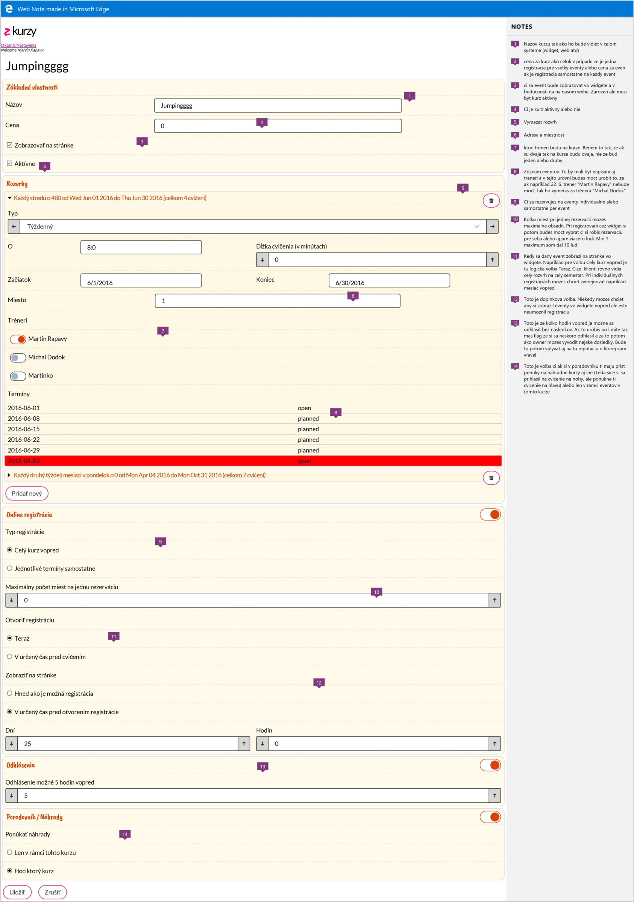

The product was **z kurzy**, in pink, and the whole menu was two words: *Zákazníci*
and *Nastavenia*. One long form held everything a course needed: basic properties,
schedules, online registration, cancellations, waiting list and make-ups. No tabs,
no sections, no search — you scrolled.

What makes this particular picture worth keeping is that it is **annotated**. Somebody
opened it in Edge's Web Note and wrote fourteen numbered notes explaining what each field
was for — why the price field means one thing for a whole-course booking and another when
each session is sold separately, what the cancellation deadline is really protecting, what
"offer make-ups" should and should not reach. It is the only surviving record of the
reasoning, not just the result.

And the reasoning holds up. Note 14 asks whether a make-up may be taken in any course or
only this one. That is, word for word, a setting in the product today. Note 3 already
says the course has to show up "in the widget and later on our website" — in month one,
with nothing built, the embeddable widget was already the plan.

### September 2016 · the name arrives

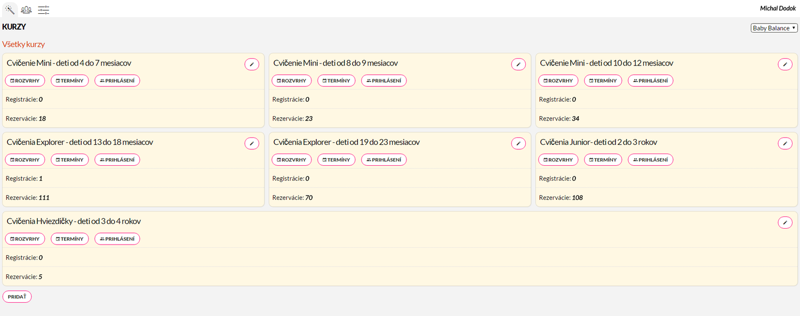

Eight weeks later the pink is gone and the app is running at **app.zooza.sk**. Courses
are cards. Each one carries three buttons — *Rozvrhy*, *Termíny*, *Prihlásenia* — and
two counters, registrations and reservations.

Those three buttons are the whole product in 2016: **a repeating pattern, the dates it
produces, and the people who signed up.** Everything since has been built around that
triangle.

### February 2017 · the rebuild

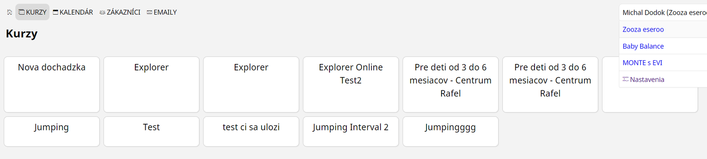

Version two. The menu is across the top — *Kurzy, Kalendár, Zákazníci, Emaily* — and
in the corner there is a **company switcher** with three companies in it. Multi-company
was in Zooza from its second year; the franchise dashboard of 2025 is the same idea,
eight years older.

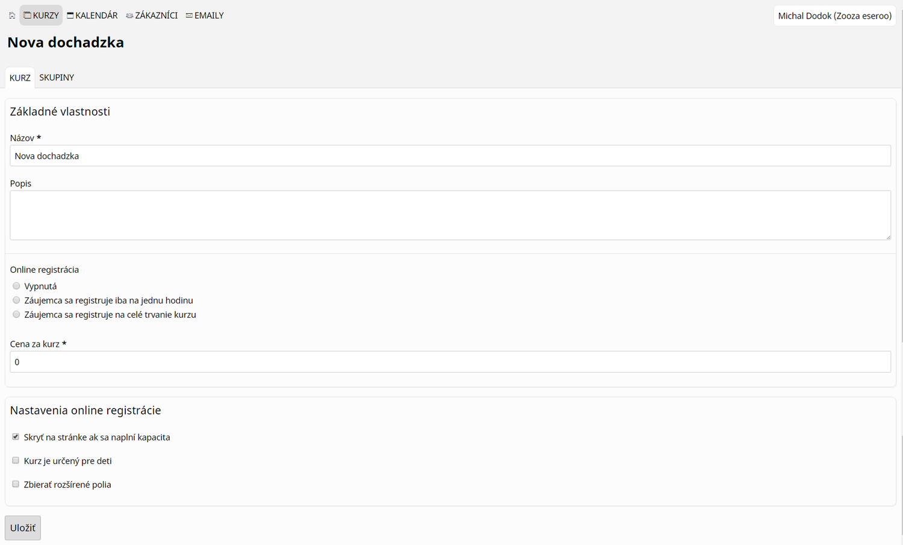

The form now has **tabs** — *Kurz* and *Skupiny* — and the one setting that matters most
is already fully formed. *Online registrácia* offers three states: off, sign up for a
single hour, or sign up for the whole course. **Pay-as-you-go versus a whole term** is
the oldest live argument in the product, and it was settled, as a choice rather than a
rule, in month eight.

### October 2017 · photographs, terms and a catalogue

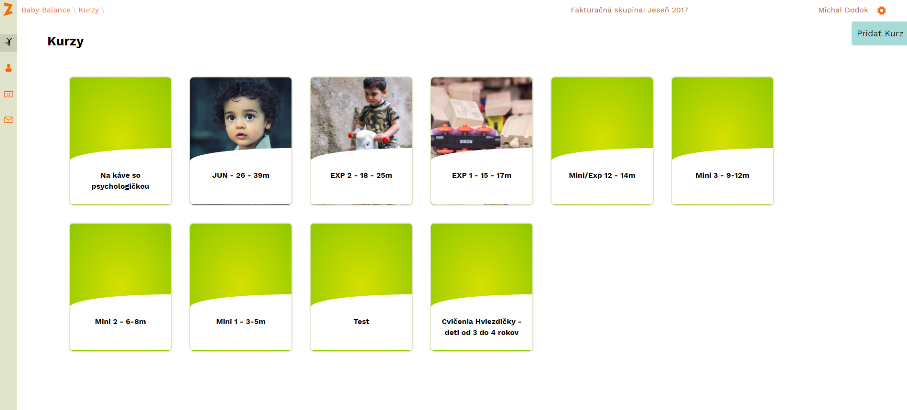

The orange **Z** is in the corner, where it still is. Courses are tiles with
photographs. The header already names a **billing period** — *Jeseň 2017* — a concept
that has never left.

Two things started here and never stopped: **a course is something you look at, not a
row in a table**, and **time is divided into named terms rather than running
continuously**.

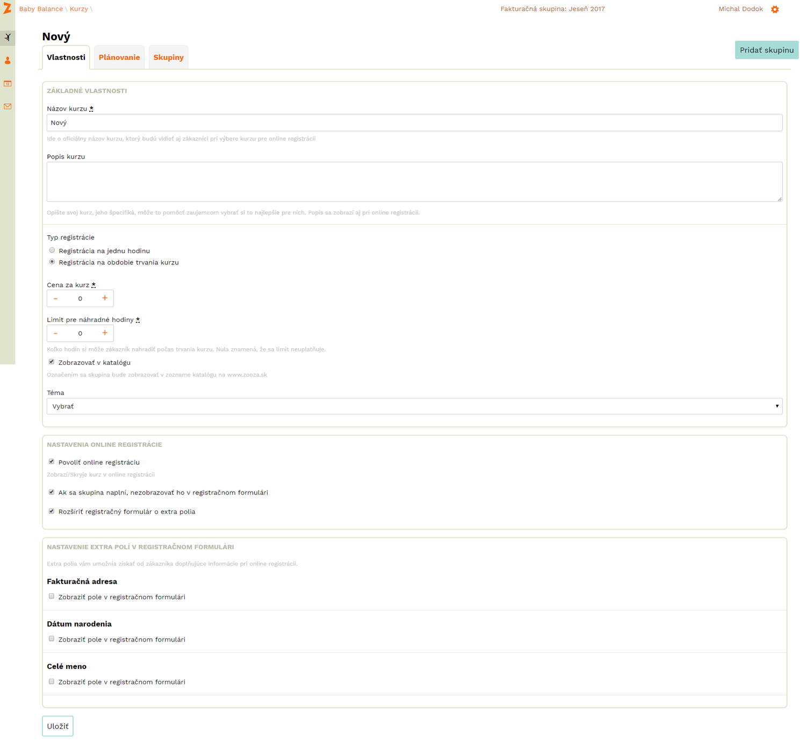

The settings behind a course in October 2017 are a short list, and every item on it is
still in the product:

- **registration type** — one hour, or the whole course;
- **a make-up limit**, with the note *zero means no limit*;
- **show in the catalogue**, which published the course on zooza.sk;
- **extra registration-form fields** — billing address, date of birth, full name — each
  switched on one at a time.

That last one is the ancestor of today's custom fields, and the note beneath it says
exactly what it says now: extra fields let you collect more from a client at sign-up.

### 2019 · the look we still have

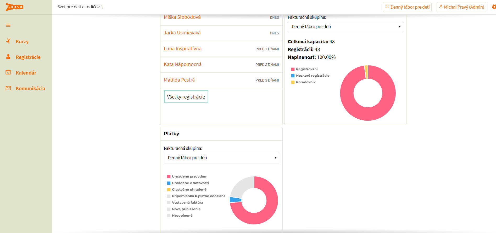

The sage-green sidebar and the orange wordmark arrive, and the app stops changing its
appearance every year. From here the visual identity is stable and the work goes into
what is behind it.

The menu is four items — *Kurzy, Registrácie, Kalendár, Komunikácia* — against today's
dozen groups, which is a fair measure of how much the product has since taken on.

The dashboard counts capacity, registrations and occupancy, and splits payments by how
they arrived. Those are the questions the Reports section answers now, with a great deal
more arithmetic behind them.

### September 2019 · the client gets a page of their own

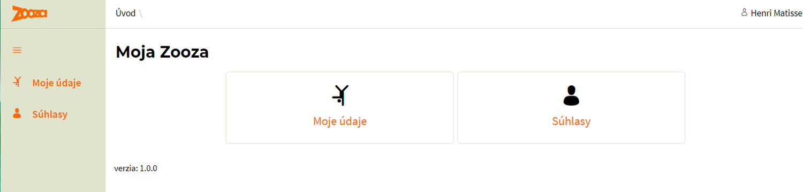

*Moja Zooza*, **version 1.0.0**, is two tiles: **my details** and **consents**. That
is the entire client zone in 2019.

It is worth seeing how small it started, because the parent zone today holds bookings,
payments, make-ups, entry passes, documents, videos and passkeys. The thing that made
version 1.0.0 necessary was not a feature request — it was GDPR. The first thing Zooza
ever let a client do for themselves was **withdraw a consent**.

### January 2020 · the calendar leaves the app

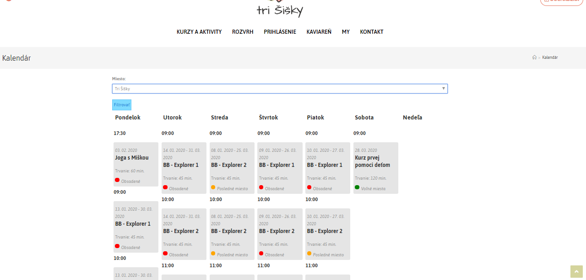

This is not the Zooza app. It is a customer's own website, with Zooza inside it — the
schedule laid out by weekday, filtered by venue, each class marked *full*, *last place*
or *places free*.

The 2016 note about "the widget and later our website" lands here. From this point the
product has **two faces**: the app the organiser works in, and the embedded pieces their
clients actually see. Every design decision since has had to work twice.

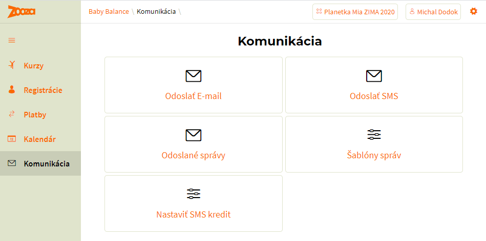

Inside the app, *Komunikácia* is five tiles: send an email, send an SMS, sent messages,
message templates, SMS credit. The menu is up to five items. Everything in the
Communication section today — campaigns, WhatsApp, automatic notifications, delivery
history — grew out of those five tiles, and the oldest one is **SMS**.

### 2020 – 2022 · one release a quarter, each with a name

The repository begins on **21 November 2020**. From here the record stops being
photographs and starts being commits.

Versions were planned in Jira and shipped as events. Each carried a name that said
what it was for, and the commit messages still link to the release report.

| Shipped | Version | Named (Slovak) | What it was for |
|---|---|---|---|
| Dec 2020 | 2.5.3 | *Servisný release Leto 2020* | Summer 2020 service release |
| Jan 2021 | 2.5.4 | *Online platby* | **Online payments** |
| Apr 2021 | 2.5.5 | *Eshop — nehmotné veci* | **The shop**, for intangible goods |
| Jul 2021 | 2.5.6 | *Fixy, BabyBalance web a Book 1* | Fixes, the BabyBalance site, Book 1 |
| Aug 2021 | 2.5.7 | *Fixy a drobné veci* | Fixes and small things |
| Sep 2021 | 2.5.8 | *Refundácie a automatické platby* | **Refunds and automatic payments** |
| Oct 2021 | 2.5.9 | *Presúvanie registrácií* | **Moving bookings** between classes |
| Nov 2021 | 2.5.10 | *Drobné fixy* | Small fixes |
| Jan 2022 | 2.5.11 | *Fakturačný systém* | **The invoicing system** |

Read down the names and the product's priorities are obvious: **take money, then sell
other things, then give money back, then move people around, then invoice for all of
it.** Each one is a quarter of work landing at once, and the order is the order in
which schools hit the problem.

### June 2022 · the people who teach

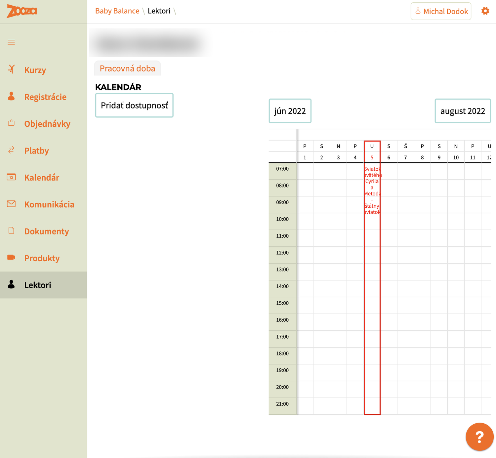

A new section — *Lektori* — and with it the idea that **an instructor is a thing the
system knows about**, not just a name typed onto a class. The profile has working hours
and a month grid for entering availability, with public holidays already marked in red.

The menu has reached nine items. *Objednávky*, *Dokumenty* and *Produkty* have appeared,
which is the shop of 2021 growing into the rest of the app. There is a help bubble in
the bottom corner.

### September 2022 · it fits in a hand

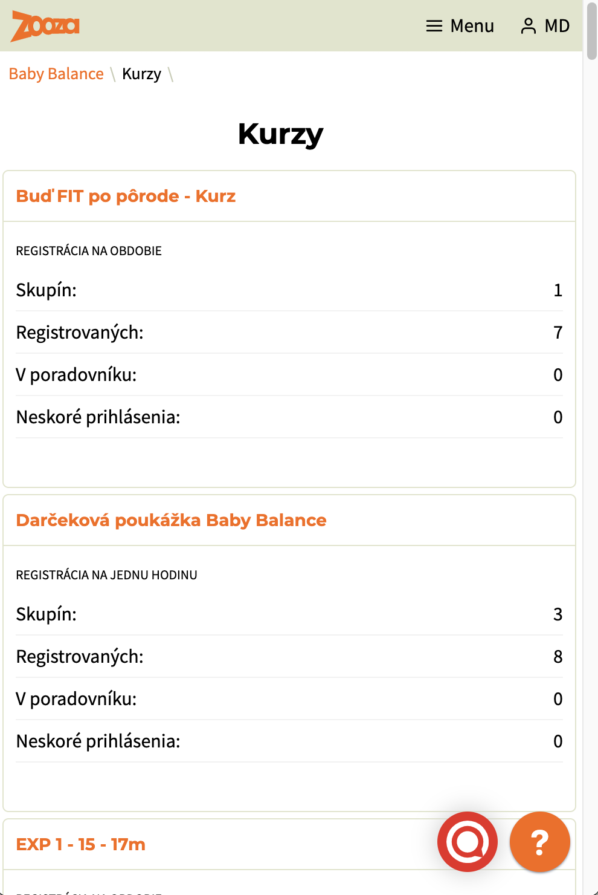

The same courses list, on a phone. Each course is a card with four numbers: groups,
registrations, **waiting list**, **late sign-ups**. The registration type — whole term
or single hour — is printed across the top of each card.

This is the point where Zooza stops being a desktop application that happens to resize.
The numbers chosen for that card are the four an organiser actually wants between two
classes, standing up.

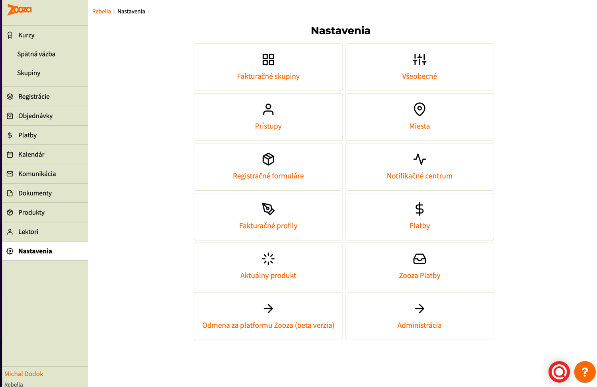

Settings is now twelve tiles, and the list reads like a product plan: billing groups,
access rights, venues, registration forms, a **notification centre**, billing profiles,
**Zooza Payments**, and — in beta — **a reward for referring the platform**. The referral
programme that shipped properly in 2025 was already running three years earlier.

### March 2023 · the dashboard answers back

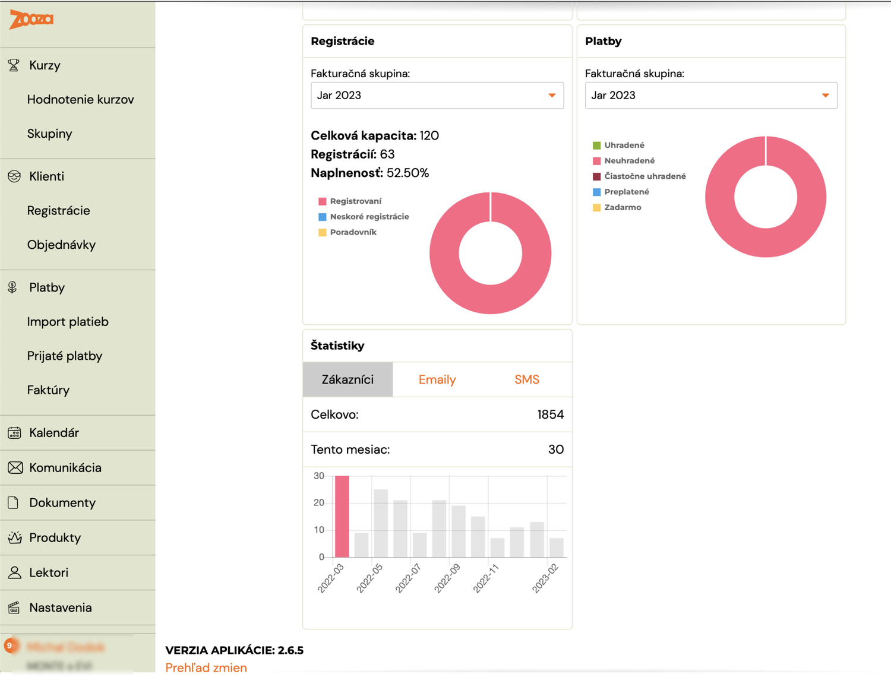

Occupancy on one side, payment status on the other, and a bar chart of new clients by
month. Payments are split five ways — paid, unpaid, part-paid, overpaid, free — which is
a more honest set of states than any accounting tool offers, and it exists because
schools genuinely have all five.

At the foot of the menu: **application version 2.6.5**, with a link to the change log.
The version number was something the customer could see.

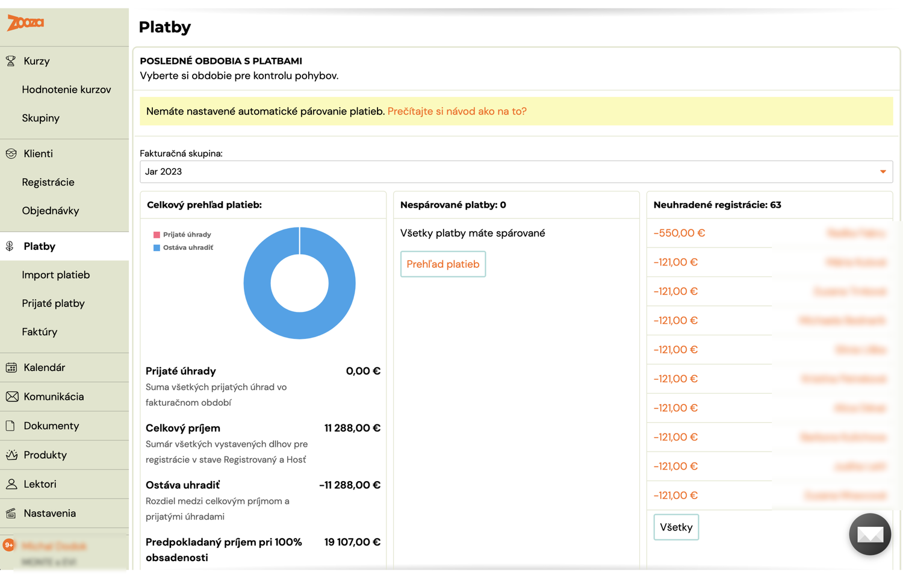

The payments screen is already asking the question it asks today — *how much is owed,
and who has not paid* — and already offering to do the matching itself. The yellow bar
reads **"you have not set up automatic payment matching"** and links to the instructions.

Rule-based matching in 2023; **AI Payment Pairing** in 2025. The job did not change, only
how well it could be done.

### December 2023 · the app speaks English

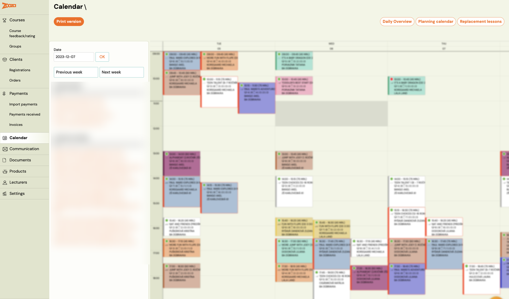

Seven years in Slovak, and then the menu is in English: *Courses, Clients, Payments,
Calendar, Communication, Documents, Products, Lecturers, Settings*. The buttons above the
calendar are **Daily Overview**, **Planning calendar** and **Replacement lessons**.

(Class names and instructors are blurred here — this is a real school's week.)

This is the single largest change in the product's history and it is invisible in a
feature list. Everything after this point had to be written twice, and every term had to
be one a stranger could understand.

### 2023 – 2024 · release branches instead of Jira versions

Jira version names stop. Work moves onto `release-*` branches merged into main, and the
names go with them.

| Shipped | Version |
|---|---|
| Mar – Jun 2023 | 2.6.6, **2.6.7**, **2.6.71** *(translations)* |
| Apr 2024 | **2.8** |
| May 2024 | **2.9** |
| Aug 2024 | **3.0** |
| Oct 2024 | **3.1** |

Four releases in 2024 against one a quarter before it. The cadence is tightening but
the shape is the same: a branch collects work for weeks, then lands in one go.

### December 2024 · the dashboard becomes a to-do list

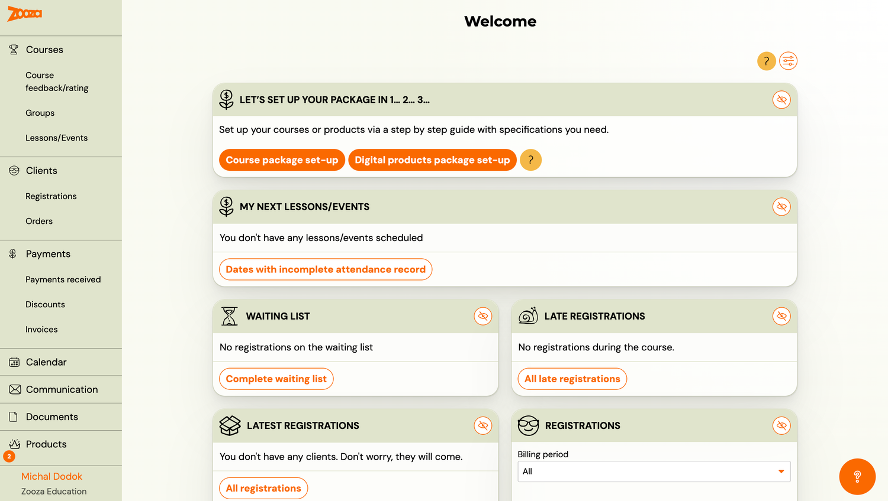

The dashboard stops reporting and starts prompting. *Let's set up your package in
1… 2… 3…* offers two guided set-ups, one for courses and one for digital products.
Below it: next lessons, **dates with an incomplete attendance record**, waiting list,
late registrations, newest registrations.

Each card is a thing that might need doing, and each one can be switched off. The empty
states were written by somebody with a sense of humour — *"You don't have any clients.
Don't worry, they will come."*

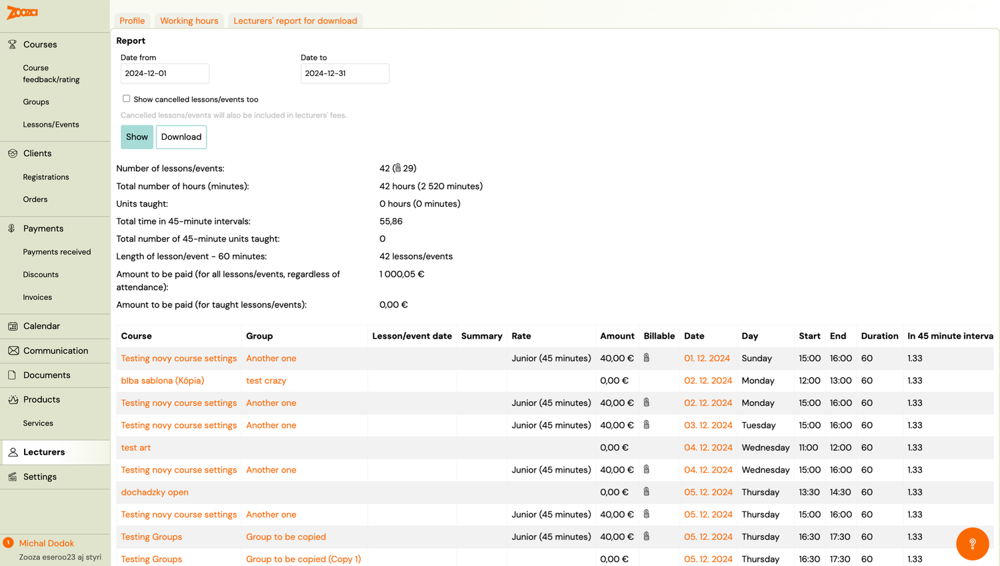

And the instructor section now does payroll. Sessions taught, total minutes, the count in
45-minute units, a per-session rate, and two separate totals: **what is owed for all
sessions** and **what is owed for sessions actually taught**. Whether a cancelled session
is paid is a question every school answers differently, so the report answers it both
ways.

### 2025 · four releases, each with a theme

| Shipped | Version | What went in |
|---|---|---|
| 28 Jan 2025 | **3.4** | |
| 28 Mar 2025 | **3.5** | |
| 9 Jun 2025 | **3.6** | |
| 16 Aug 2025 | **3.7** | WhatsApp, the course wizard, Ecomail |

The feature branches merged into 3.7 name themselves, and they say what 2025 was
about: **reaching parents where they already are.** WhatsApp instead of email,
Ecomail for bulk sending, and a wizard so setting a course up stopped being the
long form of 2016.

**3.7.5** is the first release with a full customer-facing changelog — twenty-five
entries, written for the people using it rather than for the team. A sample of what
landed in one release:

- **AI Payment Pairing** — matching bank transfers to bookings without a human
- **Fast Attendance**, **Cancellation Log**, **Payment Adjustments**
- **Referral Program**, **Sibling Discount**, **Returning Client Discount**
- **Stripe Standard Accounts**, Czech and Hungarian bank payments
- **In-App Support Chat**, the **Integrations Page**, **Custom Holidays**

### August 2025 · one company becomes a network

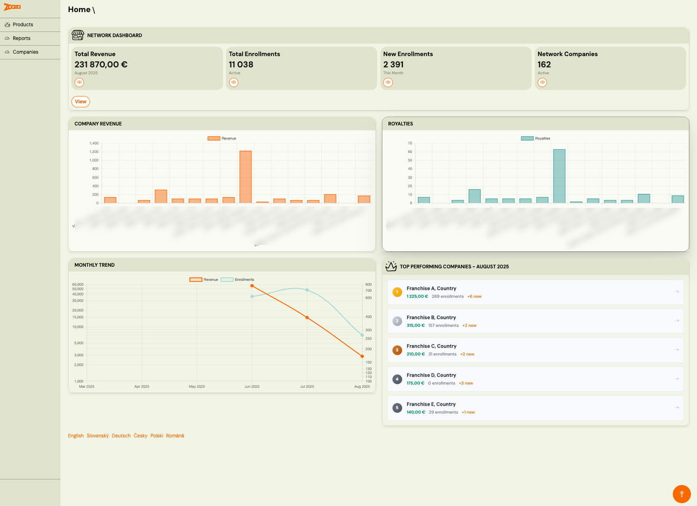

A view above the app itself: **162 companies in one network**, eleven thousand
enrolments, revenue and **royalties** charted side by side, and a ranked list of the
best-performing franchises for the month. Further down the same report, companies are
scored against each other and sixteen are flagged as needing attention.

The language switcher at the foot carries six languages — English, Slovak, German,
Czech, Polish, Romanian.

This is the 2017 company switcher grown up. A franchisor does not want to open sixteen
accounts to find out which branch is in trouble, so the question moved up a level.

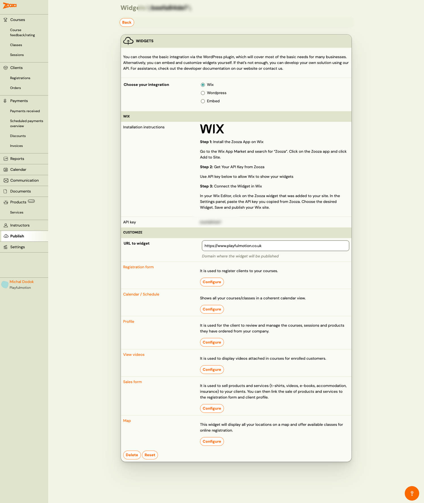

And the widget that was an idea in July 2016 is now a shelf of six: **registration form,
calendar, client profile, videos, sales form, map** — installable on Wix, on WordPress,
or by hand. This is also the screenshot where the menu first says **Classes**,
**Sessions** and **Instructors**.

### 2026 · written down before it is built, and shipped when it is done

The year opens on the old pattern and abandons it mid-way.

| Shipped | Version | Entries |
|---|---|---|
| early 2026 | **3.8** | 12 |
| | **3.8.1** | 3 |
| 30 Apr 2026 | **3.8.2** | 11 |
| 17 May 2026 | **3.8.3** | 10 |
| 28 May 2026 | **3.8.4** | 13 |

**And then the version numbers stop.** After 3.8.4 the changelog is stamped with the
month instead: `2026.06`, `2026.07`, `2026.08`, `2026.09`, `2026.10`, `2026.11`. There
is no 3.9. Work is written as a specification first, built, and shipped when it is
done — the month is just when it reached people.

**The specification system started in February 2026**, and by November it had produced
**787 implemented specs** across the three repositories:

| Month (2026) | Specs implemented |
|---|---|
| February | 14 |
| March | 69 |
| April | 82 |
| May | 80 |
| June | 64 |
| July | 52 |
| August | 49 |
| September | 111 |
| October | 81 |
| November | 61 *(to the 15th)* |

That is the real change in 2026. Not that more ships — that **nothing ships without
being written down first**, including the reasons, the things deliberately left out,
and what would have to be true for it to be correct.

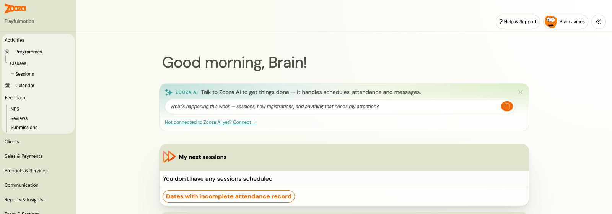

Set this against the 2019 dashboard above. The sidebar is the same colour and the
wordmark is the same orange — but the four menu items are now a dozen groups, and the
first thing on the page is **a box you type a question into**.

---

## The 2016 form, ten years on

The single most useful comparison in this page is the course form, because it is the
same job in both pictures.

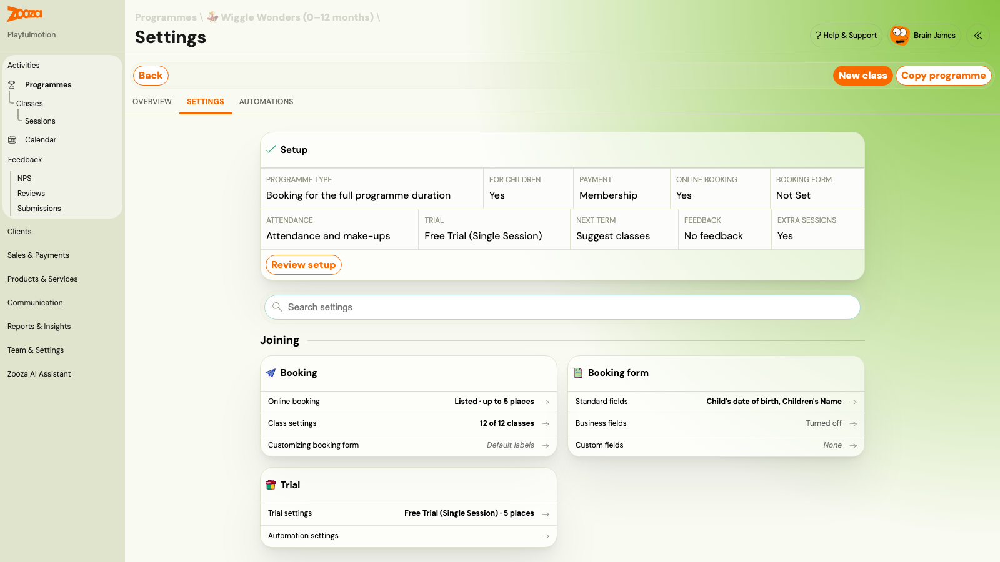

In 2016 every decision about a course sat in one scrolling form. Today the same
decisions are:

- **a Setup summary at the top** — programme type, payment, online booking, attendance,
  trial, next term, feedback, extra sessions, each showing its current answer;
- **a search box**, because there are now too many settings to scan;
- **cards grouped by what you are trying to do** — *Joining*, *Paying* and the rest —
  rather than by which database table the field belongs to.

Nothing was removed. The 2016 fields are nearly all still there — registration type,
make-up limit, extra fields, show it publicly. What changed is that the product stopped
expecting you to hold the whole thing in your head at once.

---

## How releases were made

The shipping method changed more than the product did, and in a direction worth naming.

| Era | Unit of work | How often | Decided |
|---|---|---|---|
| 2020 – 2022 | A named Jira version | Roughly quarterly | In Jira, before the quarter |
| 2023 – 2024 | A `release-*` branch | Three or four a year | In the branch, as it filled |
| 2025 | A themed release | Four a year | By theme, up front |
| 2026 | One written specification | Continuously | In the spec, before any code |

Each step moves the decision earlier and the batch smaller. The 2020 release shipped a
quarter of work and found out afterwards whether it was right. A 2026 spec states what
is in scope, what is explicitly out, and how you would know it worked — before the first
line is written.

---

## Where the pictures come from

The screenshots are from a set kept since the first month, filed by the date they were
taken: `2016-07` · `2016-09` · `2017-02` · `2017-10` · `2019-09` · `2020-01` ·
`2022-06` · `2022-09` · `2023-03` · `2023-12` · `2024-12` · `2025-08`. Seventy-six
files in all, including two presentations and a document of change notes. The 2026
screens were taken for this page.

**What the archive cannot tell you is who asked.** It records that invoicing shipped in
January 2022; it has nothing to say about the school that could not issue a document
their accountant would accept. That half of the story lives with the people who were
there, which is why *Why it changed* above is written as one honest set of reasons
rather than a motive invented for each era.
