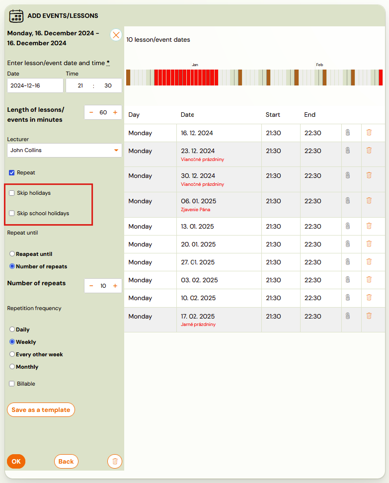
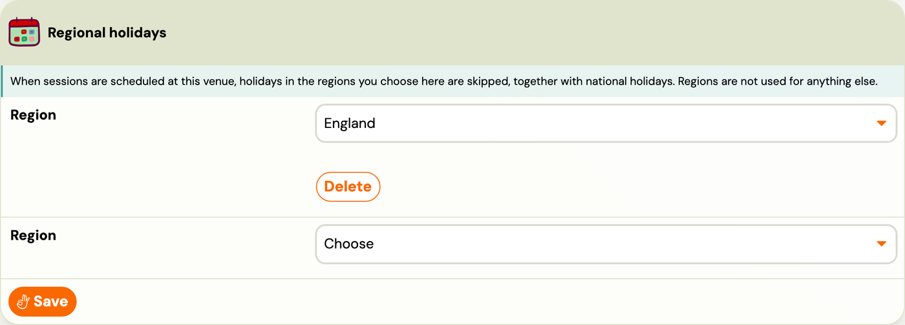
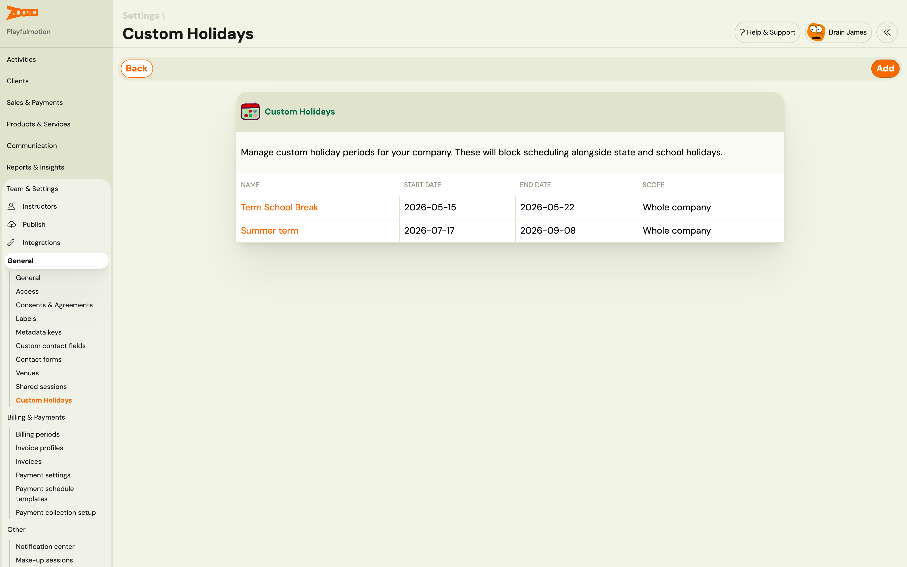

# Holiday settings

Public holidays and school breaks differ from one region to the next. Zooza pulls them in
for you, but only once each venue says which regions it follows.

## Regional holidays

Each venue carries its own list of regions. Zooza loads that region's public holidays and
school breaks, and when you create the sessions for a class it tells you which dates fall
on one. You can then:

- keep them, if you run your programmes during the holidays anyway
- delete them one by one with the **Bin** icon
- skip them automatically with the **Skip Holidays** and **Skip School breaks** checkboxes

## Which regions a venue follows

Each venue decides for itself which regional holidays apply to it. A franchise with
venues in different parts of the country gets the right school breaks at each one,
without anyone maintaining a list by hand.

1. Go to **Settings** → **Venues** and open the venue.
2. Scroll to the **Regional holidays** card.
3. Pick a region in the empty **Region** row. A new empty row appears underneath, so you
   can add another.
4. Click **Save** on that card.

The regions you are offered come from your company's country, which was set when the
account was created. If the wrong country is set, write to
[support@zooza.online](mailto:support@zooza.online) — it is not something you can change
yourself.

A venue can follow **more than one region**. When sessions are generated for a class at
that venue, a date is skipped if it is a holiday in *any* of the regions listed, plus the
national holidays. Remove a region with the **Delete** button on its row.

> **Two fields are called Region, and they are not the same.** The **Region** field in the
> venue's address card is part of the address (its help text reads *City area*) and has no
> effect on holidays. Only the **Regional holidays** card decides which holidays are
> skipped.

> **A venue with no region gets national holidays only.** This catches online venues and
> newly added ones most often. If a class keeps landing on a school break, this is the first
> thing to check.

Custom holidays are separate and already support several regions of their own — see
[Custom holidays](#custom-holidays) below.

## Rescheduling sessions and holiday rules

When you bulk-reschedule existing sessions (for example, moving all sessions from one day of the week to another), holiday-skip rules are **not** re-applied. The system treats bulk rescheduling as a manual override of already-created sessions.

This means sessions may land on public holidays or school breaks after rescheduling, even if the original sessions correctly skipped those dates.

**After any bulk reschedule, you must:**

1. Open the class and review all rescheduled sessions in the session list.
2. Check whether any sessions now fall on a holiday or school break.
3. Delete or move any unwanted sessions manually using the **Bin icon** or by rescheduling individual sessions.

> **Tip:** The system displays a warning when you perform a bulk reschedule reminding you to verify the resulting sessions. Do not skip this step.

<!-- REVIEW: Verify the exact wording of the in-app warning shown during bulk rescheduling. Support mentioned "danu hlasku sme dali aj do systemu" (we added a message to the system). -->

## Custom holidays

In addition to public and school holidays synced from the national calendar, you can create your own **custom holidays** — closures specific to your Zooza account that the system treats the same way as official holidays.

Common uses:

- Company retreat or team event
- Unexpected closure (e.g. venue unavailable)
- Local event not covered by the national calendar

Custom holidays can be **company-wide** (skip sessions across all locations) or **region-specific** (skip only sessions at locations in the selected regions).

See [Custom holidays](../guides/custom-holidays.md) for the full setup guide.

## External holiday data and accuracy

Zooza uses an external service to provide public holiday and school break data for each region. This data can sometimes be outdated or incorrect. Known issues include:

- Dates that are no longer public holidays still appearing in the system (for example, September 1 or November 17 in Slovakia).
- School break durations that do not match the current academic calendar for your specific region.

**If you suspect holiday data is wrong:**

1. Compare the holidays shown in Zooza against an official government or school calendar for your region.
2. Contact Zooza support at [support@zooza.online](mailto:support@zooza.online) to request a correction.
3. In the meantime, manually add or remove affected sessions in your classes.

> **Note:** Zooza is actively working on improving holiday data reliability. When the external service is unavailable or outdated, the team updates holiday records manually in the database.
