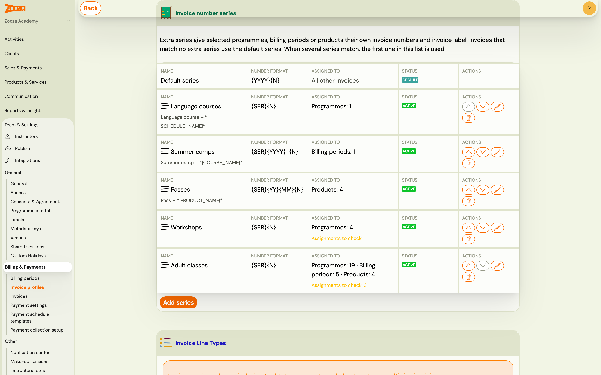
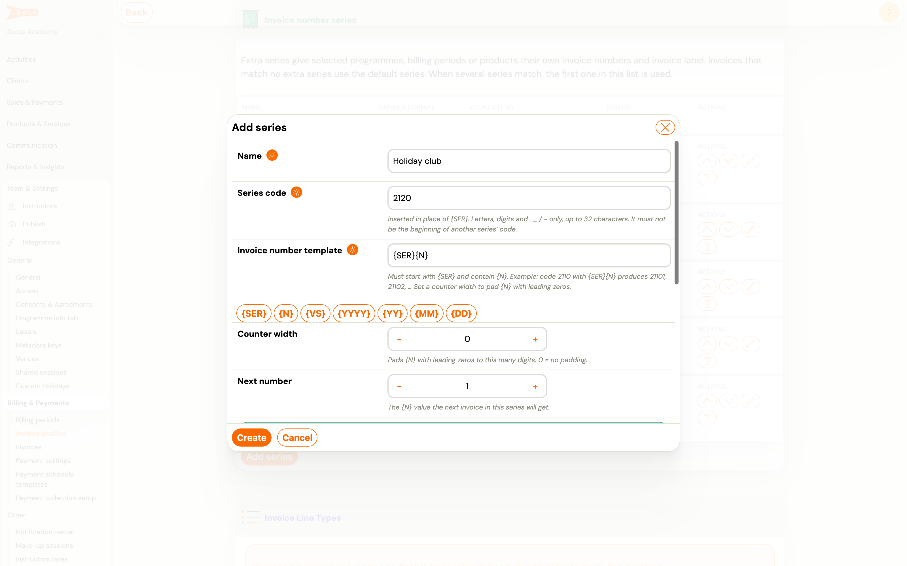
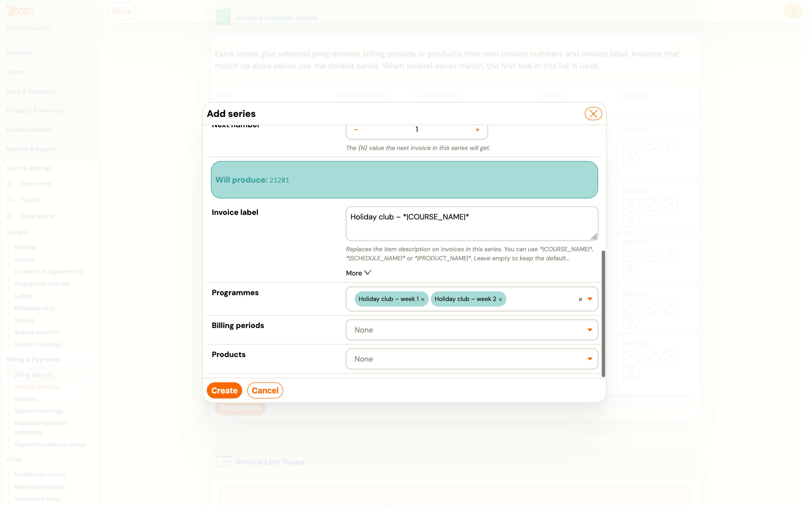
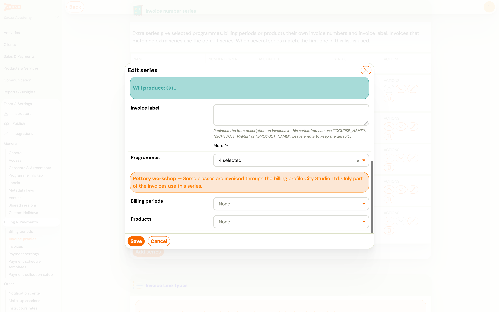
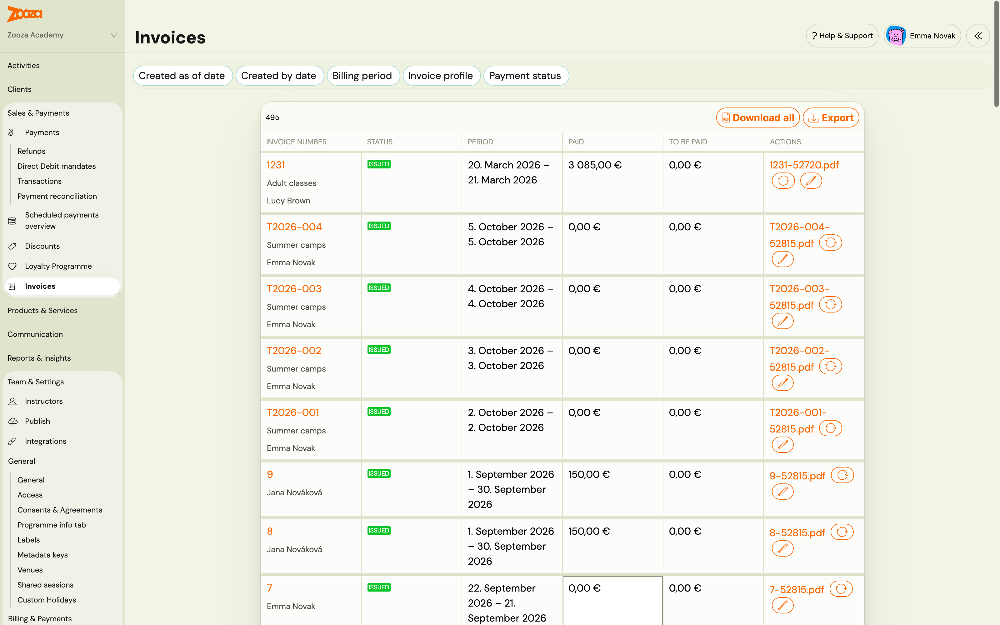
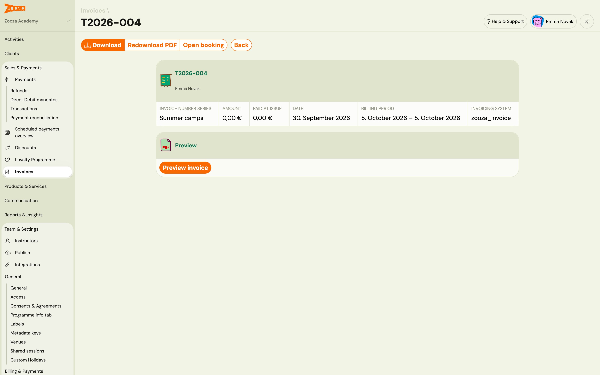
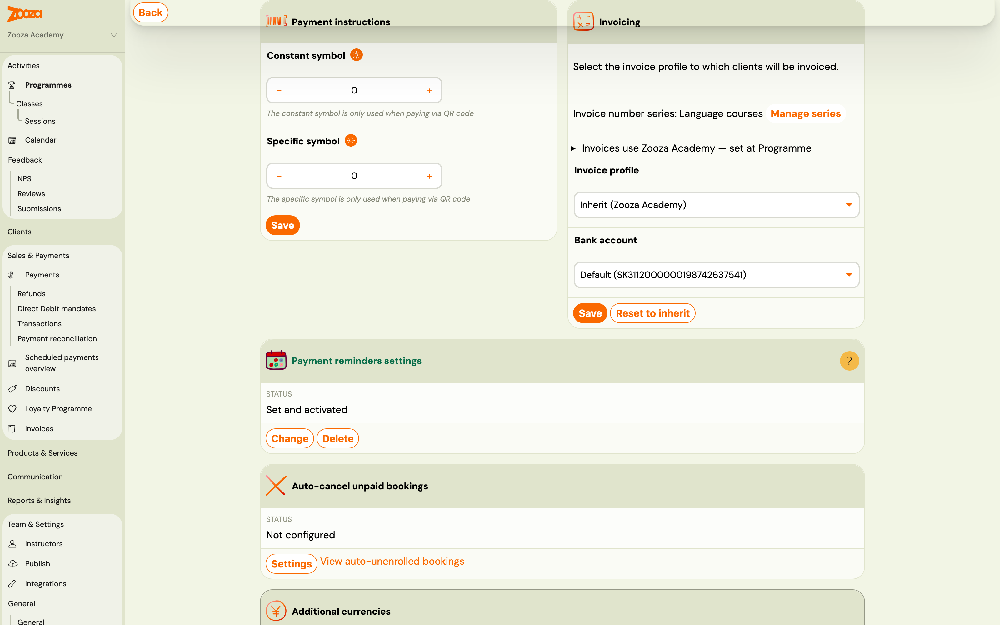

# Use several invoice number series on one invoice profile

An invoice profile numbers all its invoices in one sequence by default. Some providers need more than that: the accountant wants **summer camps numbered separately from courses**, or passes on their own series, each with its own text on the invoice.

An **invoice number series** does exactly that. You add extra series to an invoice profile and assign programmes, billing periods or products to each one. Invoices for those items get the series' number and invoice label; everything else carries on with the profile's own numbering, which becomes the **default series**.

> **Navigation:** Settings → Billing & Payments → Invoice profiles → open a profile → **Invoice number series**
> **Permission:** Owner role (or an assistant with company-editing rights)

---

## How it works

- **The default series is what you already have.** The profile's existing number format and item description stay exactly as they are and apply to every invoice that no extra series claims. Adding a series changes nothing for the rest.
- **An extra series has its own code, number format, counter and invoice label.** For example code `2120` with the format `{SER}{N}` numbers invoices `21201`, `21202`, `21203`…
- **You decide which invoices use it** by assigning programmes, billing periods or products.
- **When several series match one invoice, the first one in the list wins.** Use the up and down arrows to change the order. The full rule is in [How Zooza picks the series for an invoice](#how-zooza-picks-the-series-for-an-invoice).

The **Assigned to** column shows what each series covers, for example *Programmes: 4* or *Billing periods: 1*. **Assignments to check** means some of those assignments need a look — see [Warnings on a series](#warnings-on-a-series).

---

## How Zooza picks the series for an invoice

Every time an invoice is created, Zooza decides in this order:

1. **Which invoice profile issues the invoice.** This is the usual chain — Default profile → Programme → Class → Booking, the lowest level that has a profile set wins (see [Choose which invoice profile applies](../guides/invoice-profile-overrides.md)). For a product order it is the product's invoice profile. **Only the series of that profile are considered.** A series on another profile never applies, even if the programme is assigned to it.
2. **Which of that profile's series matches.** Zooza goes down the list of extra series from the top and takes the **first** one that contains:
   - for a booking: the booking's **programme**, or the booking's **billing period**,
   - for a product order: the **product**.

   Within one series the programme is checked before the billing period, but the order of the list always decides first: if *Summer camps* (billing period) sits above *Language courses* (programme) and a booking matches both, it gets *Summer camps*.
3. **Nothing matches → the default series.** The invoice gets the profile's own number format and description, as it would without any extra series.

A few consequences worth knowing:

- **Classes are not assigned on their own.** A class follows its programme. But if a class is invoiced through a **different invoice profile** than its programme, step 1 picks that other profile and its series — that is what the warning *Some classes are invoiced through …* tells you.
- **Deleted series are skipped**, and so are series that do not fit the profile's current invoice engine (for example SmartBill series after the profile was switched to another engine).
- **The choice is made once, when the invoice is created.** Regenerating or retrying an invoice keeps its series and its number, even if you change the assignments or the order of the list later. Only new invoices follow the new setup.

---

## Add a series

1. Open the invoice profile and scroll to **Invoice number series**.
2. Click **Add series**.
3. Fill in the form:

   | Field | What it does |
   |---|---|
   | `Name` | For you only — it identifies the series in Zooza and on the invoice list. |
   | `Series code` | Inserted wherever `{SER}` appears in the format. Letters, digits and `. _ / -`, up to 32 characters. |
   | `Invoice number template` | Must start with `{SER}` and contain `{N}`. Click the tag buttons to insert tags. |
   | `Counter width` | Pads `{N}` with leading zeros. `0` means no padding, so `2120` + `{SER}{N}` gives `21201`; width `4` would give `21200001`. |
   | `Next number` | The `{N}` value the next invoice in this series gets. Set it when you continue a series started elsewhere. |
   | `Invoice label` | Replaces the item description on invoices in this series. Leave it empty to keep the profile's default description. |

   

4. Check **Will produce** — it shows the exact number the next invoice will get.
5. Choose the **Programmes**, **Billing periods** and **Products** this series applies to. You can pick several of each.

   

6. Click **Create**.

### Tags you can use in the number format

| Tag | Meaning | Example |
|---|---|---|
| `{SER}` | The series code | `2120` |
| `{N}` | The series' own counter, padded to the counter width | `1` |
| `{VS}` | Variable symbol (booking reference number) | `12345` |
| `{YYYY}` / `{YY}` | Year, 4 or 2 digits | `2026` / `26` |
| `{MM}` / `{DD}` | Month / day, 2 digits | `07` / `15` |

Every series counts on its own: invoices in the *Summer camps* series never use up numbers of the default series, and the other way round.

### Tags you can use in the invoice label

`*|COURSE_NAME|*`, `*|SCHEDULE_NAME|*` (the class) and `*|PRODUCT_NAME|*`. A label such as `Summer camp – *|COURSE_NAME|*` prints *Summer camp – Holiday club week 1* on the invoice.

### Which description ends up on the invoice

1. A custom **Item description** you typed when editing that invoice (see [Editing a generated invoice](./billing-and-invoicing.md#editing-a-generated-invoice)).
2. Otherwise the **invoice label** of the matching series.
3. Otherwise the profile's default item description.
4. Otherwise the programme or product name.

---

## Rules for series codes

- **Codes must differ, and no code may be the beginning of another.** `21` and `2120` cannot sit on the same profile, because an invoice number starting `2120…` could belong to either.
- **A deleted series keeps its code reserved.** Its invoices still carry numbers built from that code, so a new series cannot reuse it — that would issue the same invoice number twice. Pick a new code instead. Zooza asks you to confirm and reminds you of this when you delete a series.
- If a code is rejected, the form scrolls to the message. When the code is not used by any series in the list, it belongs to a deleted series — choose another one.

---

## Warnings on a series

Open a series that shows **Assignments to check** to see what is wrong. Zooza flags:

- an assigned programme, billing period or product that has been **deleted or archived**,
- a programme where **some classes are invoiced through a different invoice profile** — those classes take their numbers from that other profile, so only part of the programme's invoices use this series.

Warnings never block invoicing. They tell you where the series will not apply as you might expect.

---

## Where you see the series afterwards

**Invoice list and invoice detail.** Each invoice shows the name of the series that numbered it under its invoice number. Invoices from the default series show no series name.

**Programme settings.** In a programme's **Price and payment** settings, the **Invoicing** card shows which series the programme's invoices use, with a **Manage series** link to the invoice profile.

**Copying a programme.** A copy keeps the original's invoice profile, bank account and series assignments, so the new programme is numbered the same way straight away.

---

## Series with an accounting system (invoice engine)

What a series contains depends on the invoice engine connected to the profile:

| Invoice engine | What you set on a series |
|---|---|
| Zooza Invoice, Faktury Online, SuperFaktura, Fakturoid, Xero | Code, number format, counter and label, as described above — Zooza builds the number. |
| SmartBill, Oblio | **Series in the invoicing system**: pick one of the series that already exist in SmartBill or Oblio. That system numbers the invoices. Create the series there first. See [SmartBill](./smartbill-invoices.md) and [Oblio](./oblio-invoices.md). |
| Számlázz.hu | **Invoice series prefix**: the name of a számlatömb (invoice pad) exactly as it is set up in Számlázz.hu. Számlázz.hu numbers the invoices. See [Számlázz.hu](./szamlazz-invoices.md). |
| ABRA Flexi | Extra series are not available — ABRA Flexi numbers invoices on its own side. |

The invoice label and the assignments work the same way for every engine.

---

## Common questions

**Do existing invoices change when I add or edit a series?**
No. A series applies to invoices generated after you save it. Issued invoices keep their numbers.

**A programme is assigned, but its invoices still use the default series.**
Check three things: the programme is not assigned to another series higher in the list; its classes are not invoiced through a different invoice profile (the series shows a warning then); and the invoice was generated after the series was saved.

**Can I use one series on several invoice profiles?**
No. A series belongs to one invoice profile, because each profile is its own legal entity with its own numbering.

---

## Related

- [Billing and invoicing](./billing-and-invoicing.md) — invoice generation, the default number format and templates
- [Set up invoice profiles and bank accounts](./invoice-profiles-and-bank-accounts.md) — the profile a series belongs to
- [Choose which invoice profile applies](../guides/invoice-profile-overrides.md) — which profile issues a booking's invoice, and therefore which series can apply
- [Invoicing in Zooza — overview](./invoicing-overview.md) — which invoice engines Zooza supports
